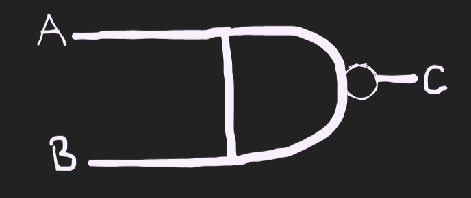
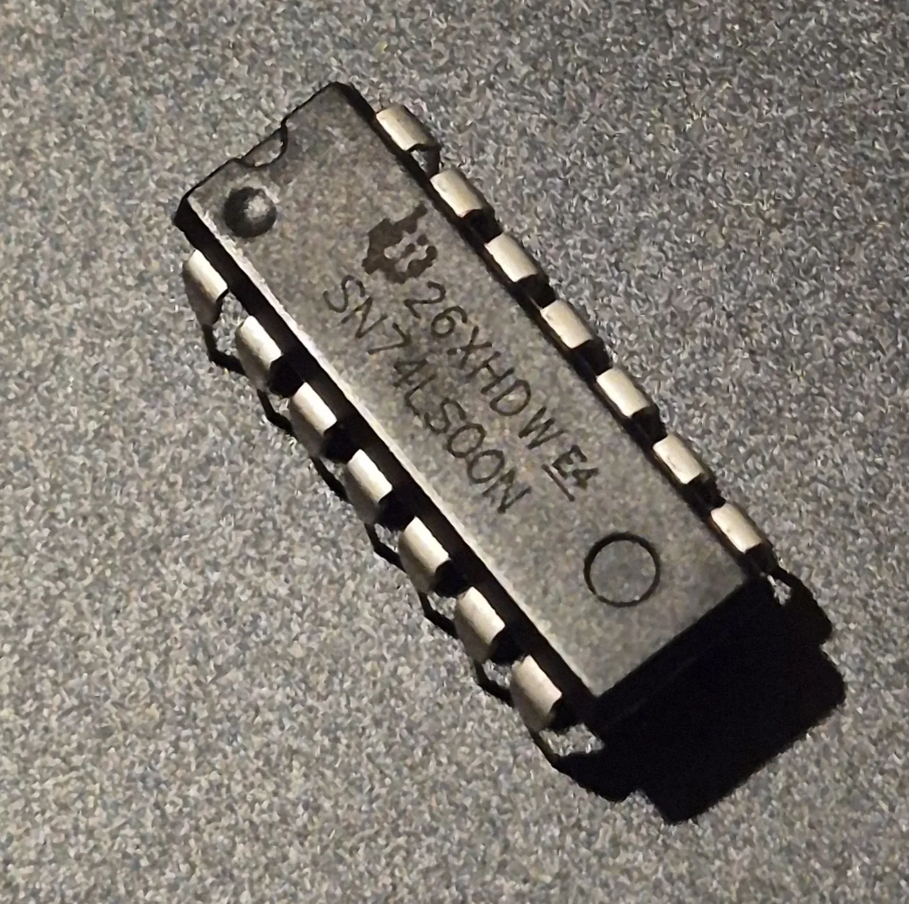
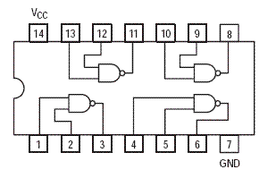
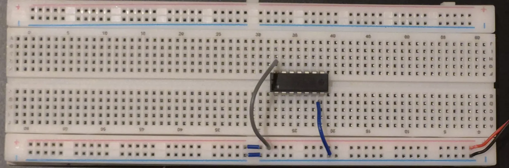
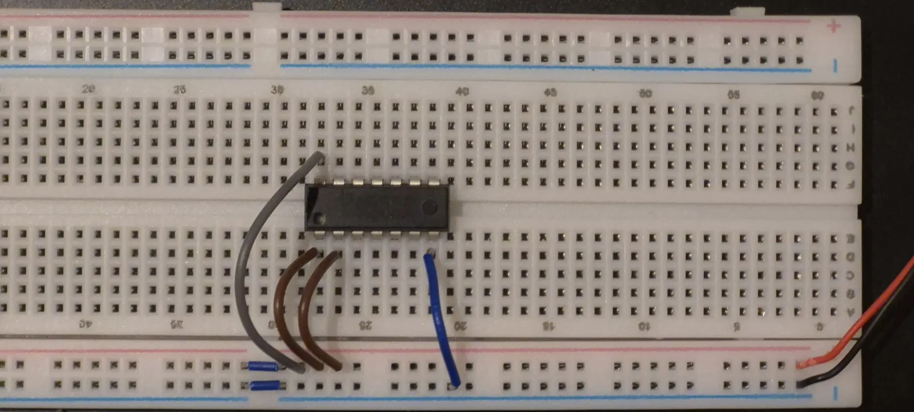
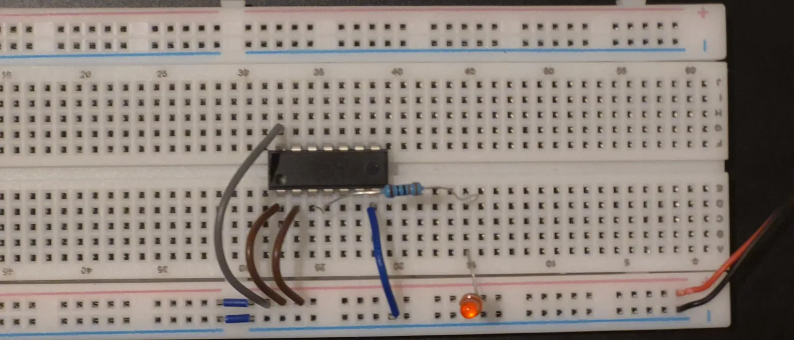
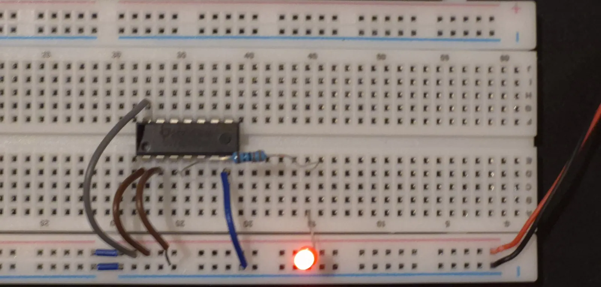
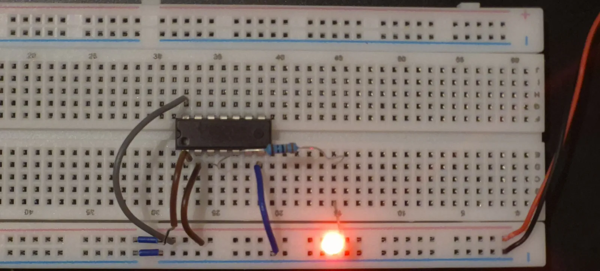
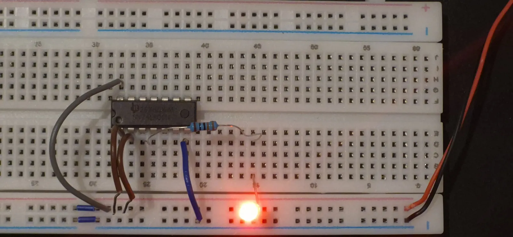

The NAND gate is an AND gate followed by a NOT gate. The name means "NOT AND". It does the opposite of AND as it turns OFF only when everything is ON.
## What is a NAND gate?

A NAND gate has two or more inputs and one output. The output is **0 (LOW)** only when **all** inputs are 1. If even one input is 0, the output is **1 (HIGH)**. For example a machine's "fault" light turns on unless the guard is closed **AND** the start button is pressed. Only when both are true does the light go off.

## Symbol

{: loading="lazy" decoding="async" width="688" height="290" }

A and B are inputs. Y is the output. The NAND symbol is the AND symbol with a small circle (a "bubble") at the tip. The bubble means "invert". (You can add an image of it here.)

## Boolean expression

```
Y = (A · B)'
```

First we AND the inputs (`A · B`), then we NOT the result (the `'` at the end). It can also be written with one long bar over AB, or as `!(A · B)`.

## Truth table (2 inputs)

| A | B | A · B | Y = (A · B)' |
|---|---|-------|--------------|
| 0 | 0 | 0 | 1 |
| 0 | 1 | 0 | 1 |
| 1 | 0 | 0 | 1 |
| 1 | 1 | 1 | 0 |

The third column shows the AND result. The NAND output is just its opposite.

## Truth table (3 inputs)

A NAND gate can have more than two inputs. For three inputs, Y = (A · B · C)'.

| A | B | C | Y |
|---|---|---|---|
| 0 | 0 | 0 | 1 |
| 0 | 0 | 1 | 1 |
| 0 | 1 | 0 | 1 |
| 0 | 1 | 1 | 1 |
| 1 | 0 | 0 | 1 |
| 1 | 0 | 1 | 1 |
| 1 | 1 | 0 | 1 |
| 1 | 1 | 1 | 0 |

Only the last row gives 0. A gate with n inputs has 2ⁿ rows, and exactly one of them gives 0.

## Boolean laws for NAND

| Law | Expression |
|-----|------------|
| With 0 | (A · 0)' = 1 |
| With 1 | (A · 1)' = A' |
| Same input | (A · A)' = A' |
| With complement | (A · A')' = 1 |
| Commutative | (A · B)' = (B · A)' |
| De Morgan's law | (A · B)' = A' + B' |

`A'` means NOT A. De Morgan's law says a NAND gate is the same as an OR gate with both inputs inverted.

## The NAND gate is a universal gate

NAND is called a **universal gate** just like NOR gate because you can build every other gate using only NAND gates.

- **NOT:** join both inputs together. Y = (A · A)' = A'.
- **AND:** NAND followed by a NOT made from a NAND. Y = ((A · B)')' = A · B.
- **OR:** invert both inputs first, then use a NAND. Y = (A' · B')' = A + B. This comes from De Morgan's law.
## NAND Gate Lab

We will be needing:
- Breadboard
- 7400 IC
- 5 V power supply
- 1 LED
- 1 resistor (220 Ω works well, anything up to 1 kΩ is fine)
- Jumper wires

We are using the **7400**. 

{: loading="lazy" decoding="async" width="1410" height="1402" }

It has four separate 2-input NAND gates inside one chip, but we will use only the first one.

{: loading="lazy" decoding="async" width="309" height="199" }

For the first gate, pins 1 and 2 are the inputs and pin 3 is the output. The other gates work the same way:

| Gate | Inputs | Output |
|------|--------|--------|
| 1 | Pins 1, 2 | Pin 3 |
| 2 | Pins 4, 5 | Pin 6 |
| 3 | Pins 9, 10 | Pin 8 |
| 4 | Pins 12, 13 | Pin 11 |

Place the chip across the middle gap of the breadboard so the two rows of pins do not touch each other. The notch on the chip marks the top. Pin 1 is on the left side of the notch. Connect **pin 14 to the HIGH supply (+5 V)** and **pin 7 to ground**. 

{: loading="lazy" decoding="async" width="1600" height="528" }

We connect one wire from the HIGH supply to pin 1 and another from the HIGH supply to pin 2. A wire connected to HIGH means that input is **1**.

{: loading="lazy" decoding="async" width="1600" height="722" }

Pin 3 is our output. We cannot connect the LED directly to pin 3 because too much current can flow and burn it.

1. Connect one leg of the resistor to pin 3.
2. Put the other leg of the resistor in any free column on the breadboard. Any column works, as long as nothing else is in it. Holes in the same column are connected together.
3. In that same column, place the **longer leg** of the LED.
4. Connect the **shorter leg** of the LED to ground.

{: loading="lazy" decoding="async" width="1600" height="687" }

**Why the long leg and short leg?**
An LED is a type of diode, and a diode lets current flow in only one direction. Current must enter through the longer leg (the positive side, called the anode) and leave through the shorter leg (the negative side, called the cathode). If we connect it the wrong way round, the LED will not light up. You can also find the short leg by the flat edge on the LED's round body.

Lets now test the truth table

| Input 1 | Input 2 | LED | Output |
| ------- | ------- | --- | ------ |
| HIGH    | HIGH    | OFF | 0      |
| HIGH    | LOW     | ON  | 1      |
| LOW     | HIGH    | ON  | 1      |
| LOW     | LOW     | ON  | 1      |

1. Both wires are on HIGH. The LED is OFF (both inputs are 1, so the output is 0).

{: loading="lazy" decoding="async" width="1600" height="687" }

2. Move **input wire 2** from HIGH to ground. The LED turns ON, because one input is now LOW.

{: loading="lazy" decoding="async" width="1600" height="766" }

3. Put wire 2 back on HIGH. The LED turns OFF again.
4. Now move **input wire 1** from HIGH to ground. The LED turns ON again.

{: loading="lazy" decoding="async" width="1600" height="724" }

5. Move **both** wires to ground. The LED stays ON.

{: loading="lazy" decoding="async" width="1600" height="740" }

This shows that for a NAND gate, the output is LOW **only when all inputs are HIGH**. If even one input is LOW, the output is HIGH. This is the exact opposite of the AND gate.

> **Tip:** Connect a LOW input to ground instead of just removing the wire. A wire connected to nothing is called a floating input, and on TTL chips like the 7400 it can act like HIGH. If you only remove the wire, the LED may stay OFF and you will not see the gate change.
