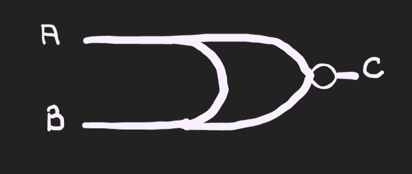
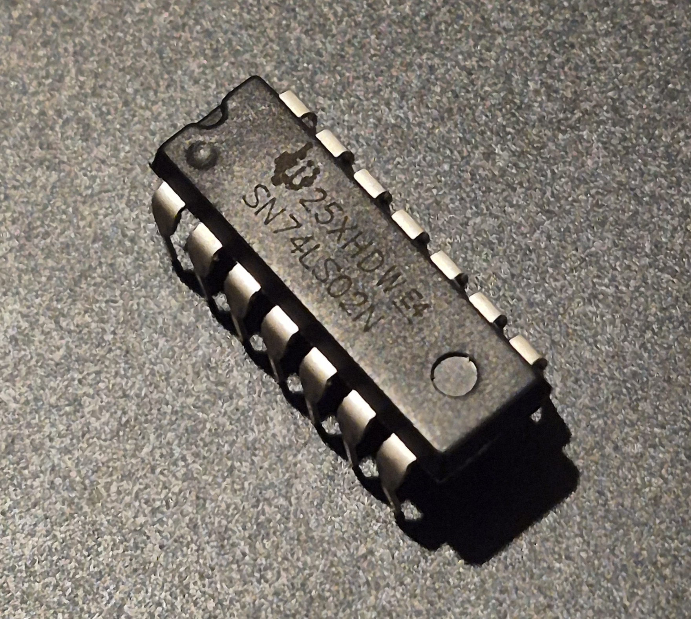
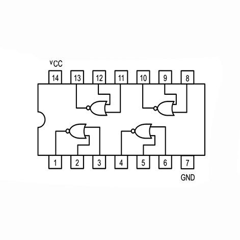
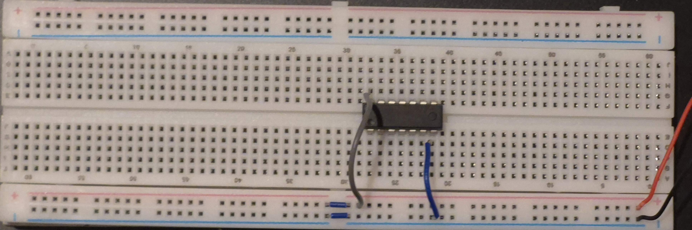
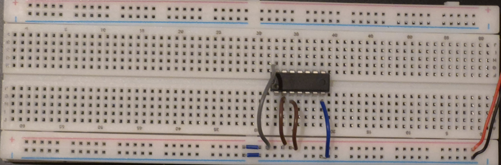
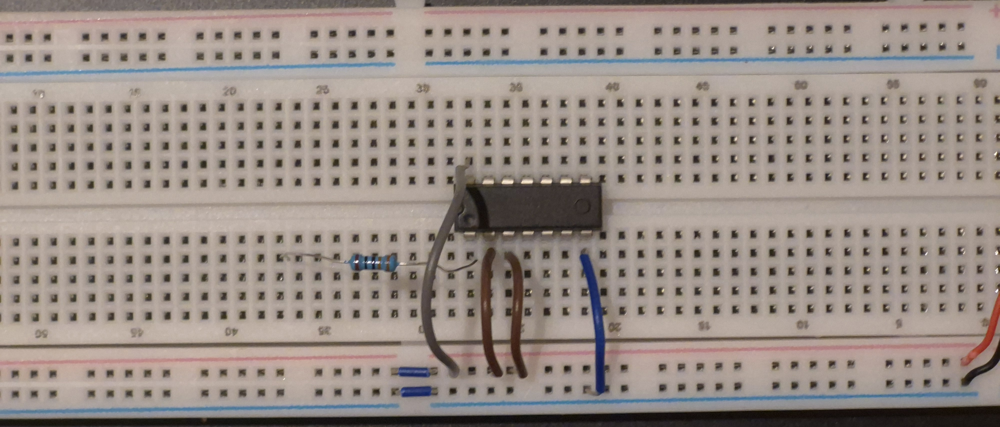
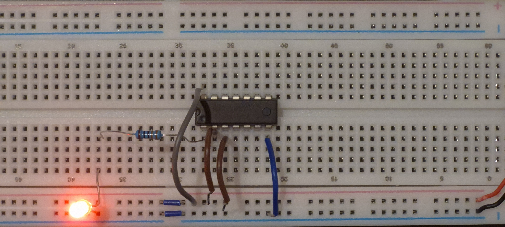
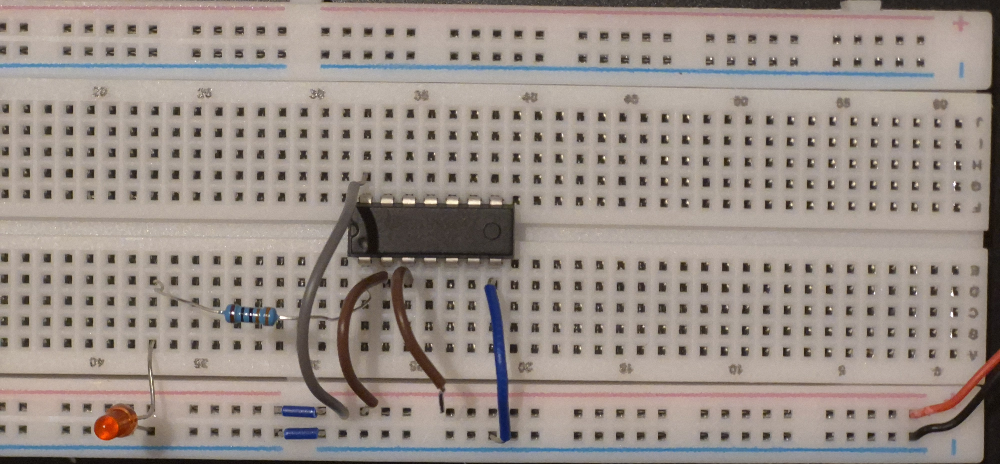
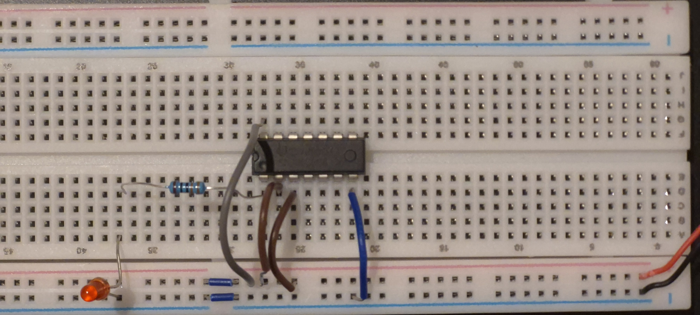
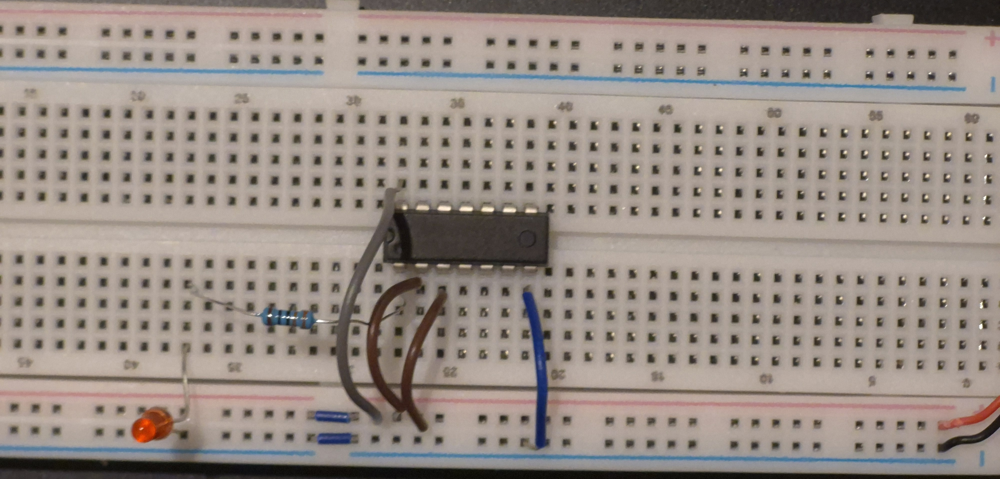

The NOR gate is an OR gate followed by a NOT gate. The name means "NOT OR". It does the opposite of OR as it turns ON only when **nothing** is ON.

## What is a NOR gate?

A NOR gate has two or more inputs and one output. The output is **1 (HIGH)** only when **all** inputs are 0. If even one input is 1, the output is **0 (LOW)**. For example a "room is empty" light turns on only if the front door sensor does **NOT** detect anyone **AND** the back door sensor does **NOT** detect anyone. If either sensor triggers, the light turns off.

## Symbol



A and B are inputs. Y is the output. The NOR symbol is the OR symbol with a small circle (a "bubble") at the tip. The bubble means "invert". 

## Boolean expression

```
Y = (A + B)'
```

First we OR the inputs (`A + B`), then we NOT the result (the `'` at the end). It can also be written as Ā+B̄ with one long bar over both, or as `!(A + B)`.

## Truth table (2 inputs)

| A | B | A + B | Y = (A + B)' |
|---|---|-------|--------------|
| 0 | 0 | 0 | 1 |
| 0 | 1 | 1 | 0 |
| 1 | 0 | 1 | 0 |
| 1 | 1 | 1 | 0 |

The third column shows the OR result. The NOR output is just its opposite.

## Truth table (3 inputs)

A NOR gate can have more than two inputs. For three inputs, Y = (A + B + C)'.

| A | B | C | Y |
|---|---|---|---|
| 0 | 0 | 0 | 1 |
| 0 | 0 | 1 | 0 |
| 0 | 1 | 0 | 0 |
| 0 | 1 | 1 | 0 |
| 1 | 0 | 0 | 0 |
| 1 | 0 | 1 | 0 |
| 1 | 1 | 0 | 0 |
| 1 | 1 | 1 | 0 |

Only the first row gives 1. A gate with n inputs has 2ⁿ rows, and exactly one of them gives 1.

## Boolean laws for NOR

| Law | Expression |
|-----|------------|
| With 0 | (A + 0)' = A' |
| With 1 | (A + 1)' = 0 |
| Same input | (A + A)' = A' |
| With complement | (A + A')' = 0 |
| Commutative | (A + B)' = (B + A)' |
| De Morgan's law | (A + B)' = A' · B' |

`A'` means NOT A. De Morgan's law says a NOR gate is the same as an AND gate with both inputs inverted.

## The NOR gate is a universal gate

NOR is called a **universal gate** because you can build every other gate using only NOR gates.

- **NOT:** join both inputs together. Y = (A + A)' = A'.
- **OR:** NOR followed by a NOT made from a NOR. Y = ((A + B)')' = A + B.
- **AND:** invert both inputs first, then use a NOR. Y = (A' + B')' = A · B. This comes from De Morgan's law.

## NOR Gate Lab

We will be needing:
- Breadboard
- 7402 IC
- 5 V power supply
- 1 LED
- 1 resistor (220 Ω works well, anything up to 1 kΩ is fine)
- Jumper wires

We are using the **7402**.



It has four separate 2-input NOR gates inside one chip, but we will use only the first one.




 Be careful here as the 7402 is different from the AND and OR chips. For the first gate, pins 2 and 3 are the inputs and **pin 1 is the output**. The other gates work the same way:

| Gate | Inputs | Output |
|------|--------|--------|
| 1 | Pins 2, 3 | Pin 1 |
| 2 | Pins 5, 6 | Pin 4 |
| 3 | Pins 8, 9 | Pin 10 |
| 4 | Pins 11, 12 | Pin 13 |

Place the chip across the middle gap of the breadboard so the two rows of pins do not touch each other. The notch on the chip marks the top. Pin 1 is on the left side of the notch. Connect **pin 14 to the HIGH supply (+5 V)** and **pin 7 to ground**. 



We connect one wire from the HIGH supply to pin 2 and another from the HIGH supply to pin 3. A wire connected to HIGH means that input is **1**.



Pin 1 is our output. We cannot connect the LED directly to pin 1 because too much current can flow and burn it. 

1. Connect one leg of the resistor to pin 1.
2. Put the other leg of the resistor in any free column on the breadboard. Any column works, as long as nothing else is in it. Holes in the same column are connected together.



3. In that same column, place the **longer leg** of the LED.
4. Connect the **shorter leg** of the LED to ground.

**Why the long leg and short leg?**
An LED is a type of diode, and a diode lets current flow in only one direction. Current must enter through the longer leg (the positive side, called the anode) and leave through the shorter leg (the negative side, called the cathode). If we connect it the wrong way round, the LED will not light up. You can also find the short leg by the flat edge on the LED's round body.

### Step 5: Test the truth table

| Input 1 | Input 2 | LED | Output |
|---------|---------|-----|--------|
| LOW | LOW | ON | 1 |
| LOW | HIGH | OFF | 0 |
| HIGH | LOW | OFF | 0 |
| HIGH | HIGH | OFF | 0 |

1. Both wires are on ground or are disconnected. The LED is ON (both inputs are 0, so the output is 1).



2. Move **input wire 2** from ground to the HIGH supply. The LED turns OFF, because one input is now HIGH.



3. Put wire 2 back on ground. The LED turns ON again.
4. Now move **input wire 1** from ground to HIGH. The LED turns OFF again.



5. Move **both** wires to HIGH. The LED stays OFF.



This shows that for a NOR gate, the output is HIGH **only when all inputs are LOW**. If even one input is HIGH, the output is LOW. This is the exact opposite of the OR gate.

> **Tip:** Always connect a LOW input to ground instead of just removing the wire. A wire connected to nothing is called a floating input, and on TTL chips like the 7402 it can act like HIGH. For a NOR gate this is easy to miss, because a floating input would keep the LED OFF and you would think the circuit is broken.


