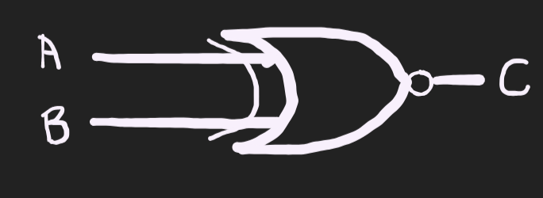
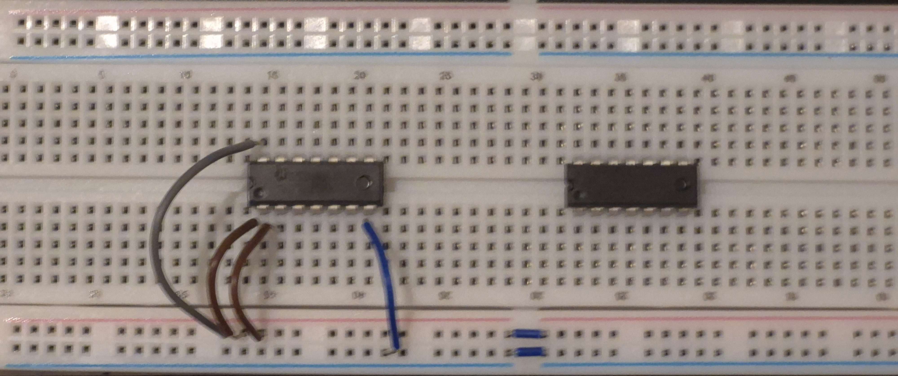
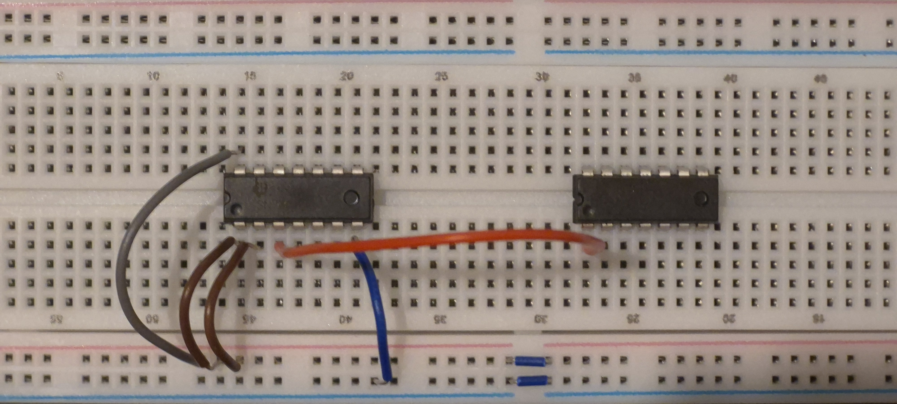
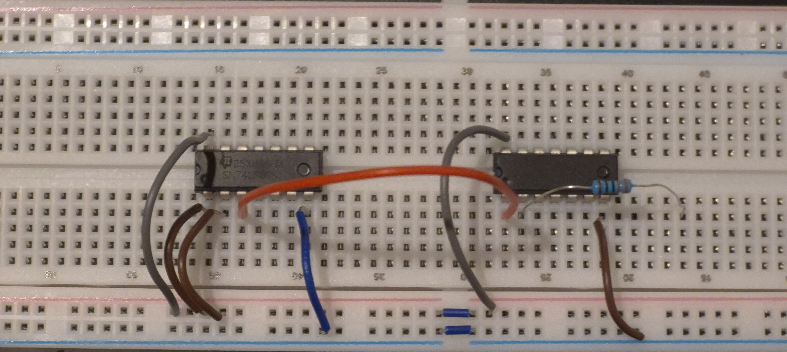
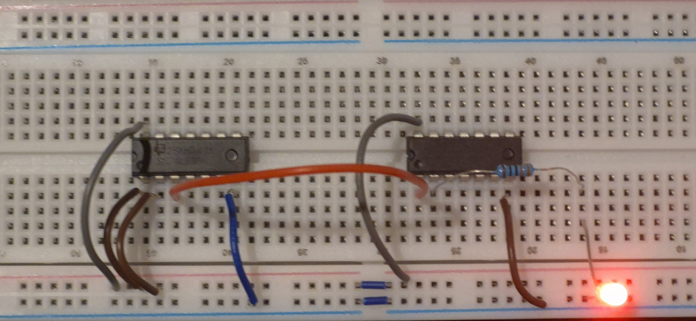
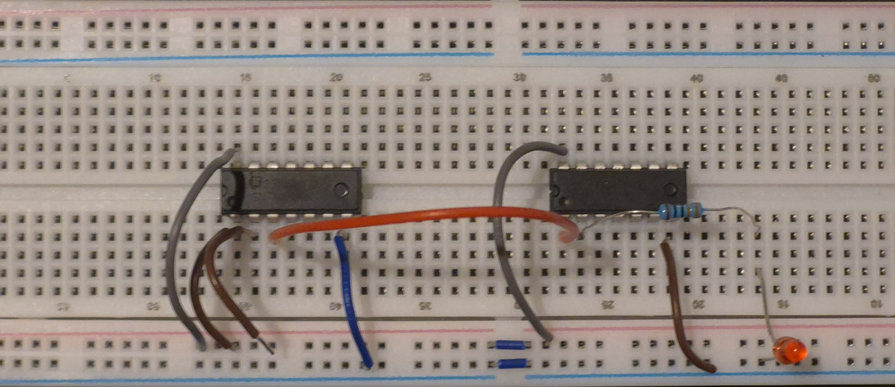
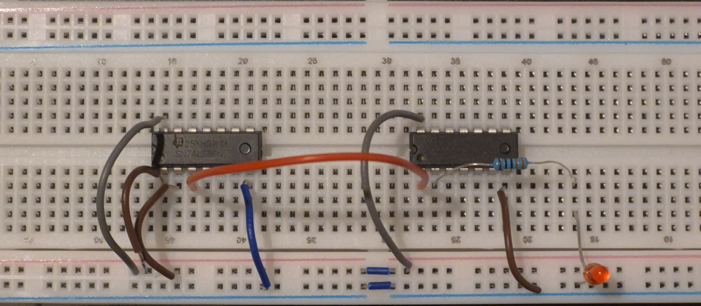
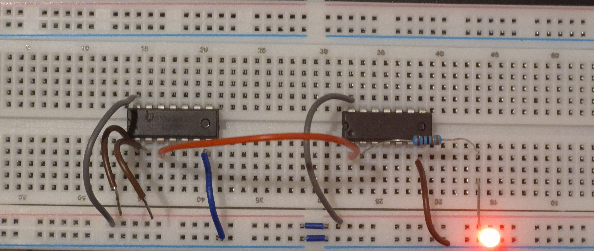

The XNOR gate is also called the **exclusive NOR** gate. It is an XOR gate followed by a NOT gate, so it does the opposite of XOR. It turns ON only when the inputs **match**. Because of this, it is also called the **equality gate**.

## What is an XNOR gate?

An XNOR gate has two inputs and one output. The output is **1 (HIGH)** when the two inputs are the **same**, either both 0 or both 1. The output is **0 (LOW)** when the two inputs are **different**. For example two judges vote yes or no. A "match" light turns on when both judges give the same vote, either both yes or both no. If they disagree, the light stays off.

## Symbol



A and B are inputs. Y is the output. The XNOR symbol is the XOR symbol with a small circle (a "bubble") at the tip. The bubble means "invert". 

## Boolean expression

```
Y = (A ⊙ B)' = A·B + A'·B'
```

The ⊙ means XOR, and the `'` at the end flips the result. The long form says: the output is 1 when both inputs are 1, or when both inputs are 0. XNOR is also written with the symbol `⊙`.

## Truth table (2 inputs)

| A   | B   | A ⊙ B | Y = (A ⊙ B)' |
| --- | --- | ----- | ------------ |
| 0   | 0   | 0     | 1            |
| 0   | 1   | 1     | 0            |
| 1   | 0   | 1     | 0            |
| 1   | 1   | 0     | 1            |

The third column shows the XOR result. The XNOR output is just its opposite.

## XNOR with more inputs

To get more inputs, we chain XOR gates and put a NOT at the end: Y = (A ⊙ B ⊙ C)'. The result is 1 when an **even number** of inputs are 1 (zero counts as even). This is called **even parity**.

| A   | B   | C   | Y = (A ⊙ B ⊙ C)' |
| --- | --- | --- | ---------------- |
| 0   | 0   | 0   | 1                |
| 0   | 0   | 1   | 0                |
| 0   | 1   | 0   | 0                |
| 0   | 1   | 1   | 1                |
| 1   | 0   | 0   | 0                |
| 1   | 0   | 1   | 1                |
| 1   | 1   | 0   | 1                |
| 1   | 1   | 1   | 0                |

Look at each row and count the 1s. The output is 1 when the count is 0 or 2.

## Boolean laws for XNOR

| Law             | Expression                |
| --------------- | ------------------------- |
| With 0          | A ⊙ 0 = A'                |
| With 1          | A ⊙ 1 = A                 |
| Same input      | A ⊙ A = 1                 |
| With complement | A ⊙ A' = 0                |
| Commutative     | A ⊙ B = B ⊙ A             |
| Associative     | (A ⊙ B) ⊙ C = A ⊙ (B ⊙ C) |

`A'` means NOT A. Notice that these are the opposite of the XOR laws.

## Building an XNOR gate from other gates

Like XOR, an XNOR gate has no simple one-transistor circuit. We usually build it from other gates instead.

**From XOR and NOT:**

```
Y = (A ⊕ B)'
```

Put a NOT gate after an XOR gate. This is the easiest way, and it is what we use in the practical below.

**From AND, OR and NOT:**

```
Y = A·B + A'·B'
```

This says both inputs are 1, or both inputs are 0.

**From 4 NOR gates:**

1. N1 = (A + B)'
2. N2 = (A + N1)'
3. N3 = (B + N1)'
4. Y = (N2 + N3)'

Because NOR is a universal gate, this circuit gives an exact XNOR using only one type of gate.

## XNOR Gate Lab  (Building an XNOR Gate with a 7486 and a 7404)

We will build XNOR by connecting an XOR gate to a NOT gate and for that we will be needing:
- Breadboard
- 7486 IC (XOR)
- 7404 IC (NOT)
- 5 V power supply
- 1 LED
- 1 resistor (220 Ω works well, anything up to 1 kΩ is fine)
- Jumper wires

We are using two ICs the **7486** (XOR) and the **7404** (NOT). Each chip has several gates inside, but we will use only the first gate of each. For each of these we are already familiar with the chip design. For XOR gate we have:

| 7486 gate | Inputs      | Output |
| --------- | ----------- | ------ |
| 1         | Pins 1, 2   | Pin 3  |
| 2         | Pins 4, 5   | Pin 6  |
| 3         | Pins 9, 10  | Pin 8  |
| 4         | Pins 12, 13 | Pin 11 |

For the first NOT gate of the 7404, pin 1 is the input and pin 2 is the output:

| 7404 gate | Input  | Output |
| --------- | ------ | ------ |
| 1         | Pin 1  | Pin 2  |
| 2         | Pin 3  | Pin 4  |
| 3         | Pin 5  | Pin 6  |
| 4         | Pin 9  | Pin 8  |
| 5         | Pin 11 | Pin 10 |
| 6         | Pin 13 | Pin 12 |

Place both chips across the middle gap of the breadboard so the two rows of pins do not touch each other. The notch on each chip marks the top. Pin 1 is on the left side of the notch. On **each** chip, we connect **pin 14 to the HIGH supply (+5 V)** and **pin 7 to ground** (In the image below I haven't yet connected NOT gate's pins 14 and 7 to HIGH supply and ground respectively)



We connect one wire from the HIGH supply to pin 1 of the 7486 and another from the HIGH supply to pin 2 of the 7486. A wire connected to HIGH means that input is **1** and then connect a wire from **pin 3 of the 7486** (the XOR output) to **pin 1 of the 7404** (the NOT input). The XOR output goes into the NOT gate, which flips it. XOR followed by NOT is an XNOR gate.



Pin 2 of the 7404 is our final output. 

1. Connect one leg of the resistor to pin 2 of the 7404.
2. Put the other leg of the resistor in any free column on the breadboard. Any column works, as long as nothing else is in it. Holes in the same column are connected together.



3. In that same column, place the **longer leg** of the LED.
4. Connect the **shorter leg** of the LED to ground.

### Testing the truth table

| Input 1 | Input 2 | XOR output | LED | Output |
|---------|---------|------------|-----|--------|
| HIGH | HIGH | 0 | ON | 1 |
| HIGH | LOW | 1 | OFF | 0 |
| LOW | HIGH | 1 | OFF | 0 |
| LOW | LOW | 0 | ON | 1 |

1. Both wires are on HIGH. The XOR gate gives 0, the NOT gate flips it to 1, and the LED is ON.



2. Move **input wire 2** from HIGH to ground. The XOR gate gives 1, the NOT gate flips it to 0, and the LED turns OFF.



3. Put wire 2 back on HIGH. The LED turns ON again.
4. Now move **input wire 1** from HIGH to ground. The LED turns OFF again.



5. Move **both** wires to ground. The XOR gate gives 0, the NOT gate gives 1, and the LED turns ON.



This shows that for an XNOR gate, the output is HIGH **only when the inputs are the same**. This is the opposite of the XOR gate.

> **Tip:** Connect a LOW input to ground instead of just removing the wire. A wire connected to nothing is called a floating input, and on TTL chips like the 7486 it can act like HIGH. If you only remove the wire, the LED may stay ON and you will think the gate is broken.


