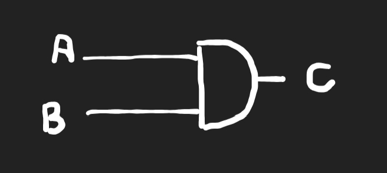
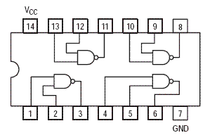
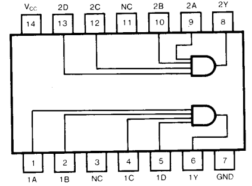

The AND gate is another basic logic gate, along with OR and NOT. It is the "strict" gate as every input has to agree before the output turns on.

## What is an AND gate?

An AND gate has two or more inputs and one output. The output is **1 (HIGH)** only when **all** inputs are 1. If even one input is 0, the output is **0 (LOW)**. For example A machine starts only if the safety guard is closed **AND** you press the start button. If either one is missing, the machine stays off.

## Symbol



A and B are inputs. Y is the output. The AND symbol has a flat back and a curved front. 

## Boolean expression
```
Y = A · B
```

The `·` means **AND**. It is also written as `AB`, and it works like multiplication: `1 · 1 = 1`, and anything times 0 is 0.

## Truth table (2 inputs)

| A   | B   | Y = A · B |
| --- | --- | --------- |
| 0   | 0   | 0         |
| 0   | 1   | 0         |
| 1   | 0   | 0         |
| 1   | 1   | 1         |

## Truth table (4 inputs)

An AND gate can have more than two inputs. For four inputs, Y = A · B · C · D.

| A   | B   | C   | D   | Y   |
| --- | --- | --- | --- | --- |
| 0   | 0   | 0   | 0   | 0   |
| 0   | 0   | 0   | 1   | 0   |
| 0   | 0   | 1   | 0   | 0   |
| 0   | 0   | 1   | 1   | 0   |
| 0   | 1   | 0   | 0   | 0   |
| 0   | 1   | 0   | 1   | 0   |
| 0   | 1   | 1   | 0   | 0   |
| 0   | 1   | 1   | 1   | 0   |
| 1   | 0   | 0   | 0   | 0   |
| 1   | 0   | 0   | 1   | 0   |
| 1   | 0   | 1   | 0   | 0   |
| 1   | 0   | 1   | 1   | 0   |
| 1   | 1   | 0   | 0   | 0   |
| 1   | 1   | 0   | 1   | 0   |
| 1   | 1   | 1   | 0   | 0   |
| 1   | 1   | 1   | 1   | 1   |

Only the last row gives 1. A gate with n inputs has 2ⁿ rows, and exactly one of them gives 1.

## Boolean laws for AND

| Law              | Expression                |
| ---------------- | ------------------------- |
| Identity         | A · 1 = A                 |
| Null (dominance) | A · 0 = 0                 |
| Idempotent       | A · A = A                 |
| Complement       | A · A' = 0                |
| Commutative      | A · B = B · A             |
| Associative      | (A · B) · C = A · (B · C) |

`A'` means NOT A.
## AND gate ICs 7408 and 7421

- The **7408** has four separate 2-input AND gates inside one chip. It is a 14-pin IC.
- The **7421** has two separate **4-input** AND gates inside one chip. It is also a 14-pin IC.

On both chips, pin 14 is VCC (+5 V) and pin 7 is GND.

## AND Gate Lab
For this lab we need:
- Breadboard
- 7408 IC
- 5 V power supply
- 1 LED
- 1 resistor (220 Ω works well, anything up to 1 kΩ is fine)
- Jumper wires

Firs we are going to use the **7408**. 


It has four separate 2-input AND gates inside one chip, but we will use only the first one.



The diagram is quite self explanatory. For the first gate, pins 1 and 2 are the inputs and pin 3 is the output. The other gates work the same way:

| Gate | Inputs      | Output |
| ---- | ----------- | ------ |
| 1    | Pins 1, 2   | Pin 3  |
| 2    | Pins 4, 5   | Pin 6  |
| 3    | Pins 9, 10  | Pin 8  |
| 4    | Pins 12, 13 | Pin 11 |

Place the chip across the middle gap of the breadboard so the two rows of pins do not touch each other. The notch on the chip marks the top. Pin 1 is on the left side of the notch.


Every IC needs power to work. We connect **pin 14 to the HIGH supply (+5 V)** and **pin 7 to ground**. Without this, the gates will not work, even if the inputs are correct.


We connect one wire from the HIGH supply to pin 1 and another from the HIGH supply to pin 2. A wire connected to HIGH means that input is **1**.


Pin 3 is our output. We cannot connect the LED directly to pin 3 because too much current can flow and burn it. An LED has no built in protection, so we need a resistor to limit the current.


1. Connect one leg of the resistor to pin 3.
2. Put the other leg of the resistor in any free column on the breadboard. Any column works, as long as nothing else is in it. Holes in the same column are connected together.
3. In that same column, place the **longer leg** of the LED.
4. Connect the **shorter leg** of the LED to ground.


**Why the long leg and short leg?**
An LED is a type of diode, and a diode lets current flow in only one direction. Current must enter through the longer leg (the positive side, called the anode) and leave through the shorter leg (the negative side, called the cathode). If we connect it the wrong way round, the LED will not light up. You can also find the short leg by the flat edge on the LED's round body.

Lets test the truth table now:

| Input 1 | Input 2 | LED | Output |
| ------- | ------- | --- | ------ |
| HIGH    | HIGH    | ON  | 1      |
| HIGH    | LOW     | OFF | 0      |
| LOW     | HIGH    | OFF | 0      |
| LOW     | LOW     | OFF | 0      |

1. Both wires are on HIGH. The LED is ON (1 · 1 = 1).


2. Move **input wire 2** from HIGH to ground. The LED turns OFF, because one input is now LOW.


3. Put wire 2 back on HIGH. The LED turns ON again.


4. Now move **input wire 1** from HIGH to ground. The LED turns OFF again.


This shows that for an AND gate, **all inputs must be HIGH** for the output to be HIGH. If even one input is LOW, the output is LOW.

> **Tip:** Connect a LOW input to ground instead of just removing the wire. A wire connected to nothing is called a floating input, and on TTL chips like the 7408 it can act like HIGH. If you only remove the wire, the LED may stay ON and confuse you.

Now let test the 4-Input AND Gate with a 7421! For this we again need:
- Breadboard
- 7421 IC
- 5 V power supply
- 1 LED
- 1 resistor (220 Ω)
- Jumper wires

We are using the **7421**.


It has two separate 4-input AND gates inside one chip, but we will use only the first one.



For the first gate, pins 1, 2, 4 and 5 are the inputs and pin 6 is the output. The second gate works the same way:

| Gate | Inputs             | Output |
| ---- | ------------------ | ------ |
| 1    | Pins 1, 2, 4, 5    | Pin 6  |
| 2    | Pins 9, 10, 12, 13 | Pin 8  |

Pins 3 and 11 are not connected to anything inside the chip, so we leave them empty.

Same as before we connect **pin 14 to the HIGH supply (+5 V)** and **pin 7 to ground**.


We connect four wires from the HIGH supply, one each to pins 1, 2, 4 and 5. Now all four inputs are **1**.


Pin 6 is our output. As before, we need a resistor before the LED.
1. Connect one leg of the resistor to pin 6.
2. Put the other leg of the resistor in any free column.
3. In that same column, place the **longer leg** of the LED.
4. Connect the **shorter leg** of the LED to ground.

Lets again test the truth table

| Input 1 | Input 2 | Input 3 | Input 4 | LED | Output |
|---------|---------|---------|---------|-----|--------|
| HIGH | HIGH | HIGH | HIGH | ON | 1 |
| LOW | HIGH | HIGH | HIGH | OFF | 0 |
| HIGH | LOW | HIGH | HIGH | OFF | 0 |
| HIGH | HIGH | LOW | HIGH | OFF | 0 |
| HIGH | HIGH | HIGH | LOW | OFF | 0 |
| LOW | LOW | LOW | LOW | OFF | 0 |

1. All four wires are on HIGH. The LED is ON.


2. Move any **one** wire to ground. The LED turns OFF.


In the above image I disconnected input wire 4 and the in the image below I disconnected input wire 5 and the output went LOW.


3. Put it back on HIGH, then try each of the other three wires one by one. Every time, the LED turns OFF.
4. Move all four wires to ground. The LED stays OFF.

The LED is ON in only 1 of the 16 possible combinations: when all four inputs are HIGH.


