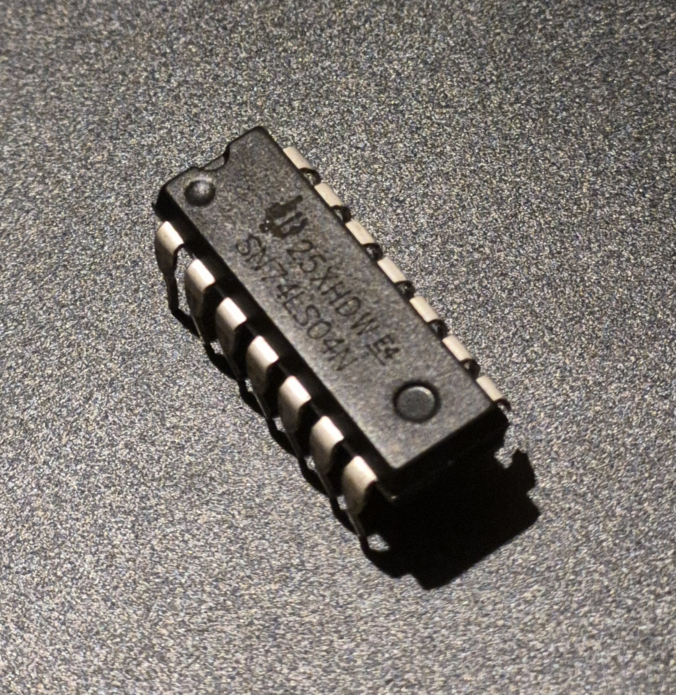
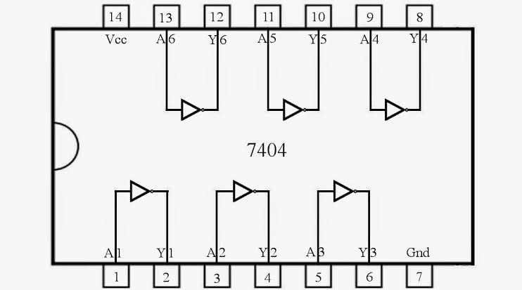
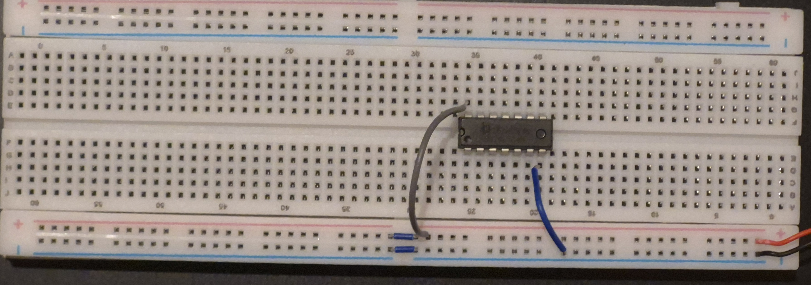
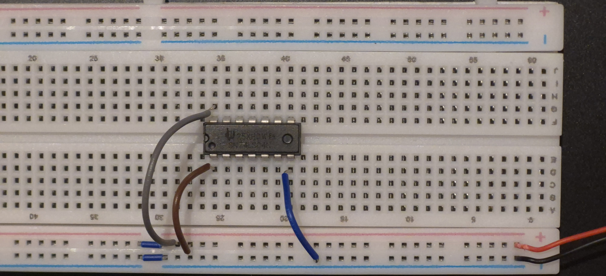
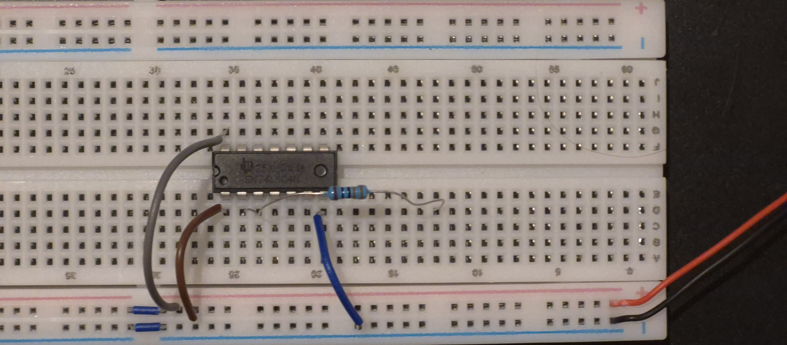
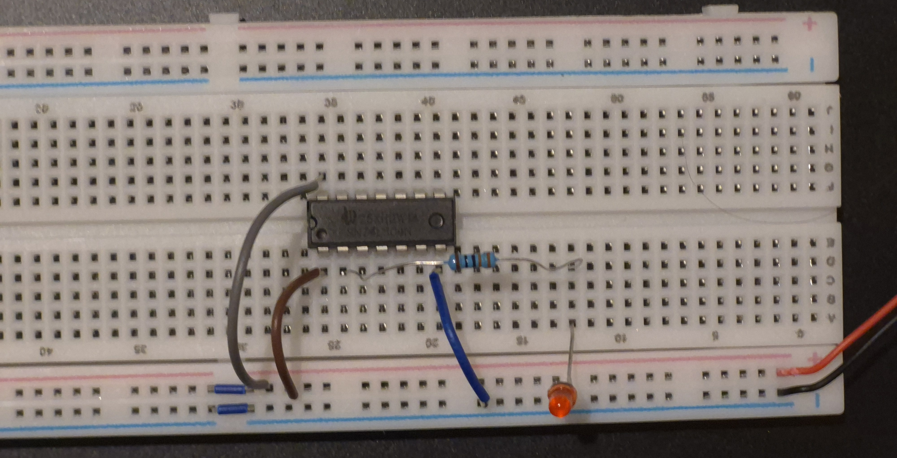
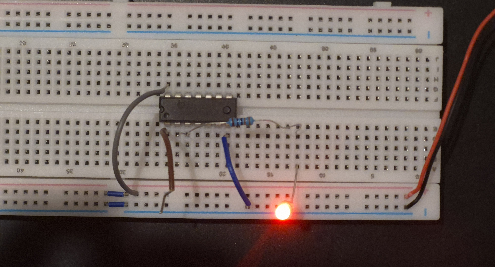

The NOT gate is the simplest logic gate. It has only **one input**, and its job is to flip it. It is also called an **inverter**.
## What is a NOT gate?

A NOT gate has one input and one output. If the input is 1 (HIGH), the output is 0 (LOW). If the input is 0 (LOW), the output is 1 (HIGH). The output is always the opposite of the input. Think of a normal light switch that works backwards. When you press it (1), the light turns off (0). When you release it (0), the light turns on (1).

## Symbol


A is the input. Y is the output. The NOT symbol is a triangle with a small circle (a "bubble") at the tip. The triangle means "buffer", and the bubble means "invert". (You can add an image of it here.)

## Boolean expression

```
Y = A'
```

`A'` is read as "A bar" or "NOT A". You may also see it written as Ā or !A.

## Truth table

| A | Y = A' |
|---|--------|
| 0 | 1 |
| 1 | 0 |

With only one input, there are just 2 rows.

## Boolean laws for NOT

| Law | Expression |
|-----|------------|
| Complement (OR) | A + A' = 1 |
| Complement (AND) | A · A' = 0 |
| Double negation | (A')' = A |
| NOT of 0 | 0' = 1 |
| NOT of 1 | 1' = 0 |

The double negation law means that two NOT gates in a row cancel each other out.
## NOT Gate Lab

We will be needing:
- Breadboard
- 7404 IC
- 5 V power supply
- 1 LED
- 1 resistor (220 Ω works well, anything up to 1 kΩ is fine)
- Jumper wires

We are using the **7404**. 



It has six separate NOT gates inside one chip, but we will use only the first one.



For the first gate, pin 1 is the input and pin 2 is the output. The other gates work the same way:

| Gate | Input  | Output |
| ---- | ------ | ------ |
| 1    | Pin 1  | Pin 2  |
| 2    | Pin 3  | Pin 4  |
| 3    | Pin 5  | Pin 6  |
| 4    | Pin 9  | Pin 8  |
| 5    | Pin 11 | Pin 10 |
| 6    | Pin 13 | Pin 12 |

Place the chip across the middle gap of the breadboard so the two rows of pins do not touch each other. The notch on the chip marks the top. Pin 1 is on the left side of the notch. We connect **pin 14 to the HIGH supply (+5 V)** and **pin 7 to ground**. 



We connect one wire from the HIGH supply to pin 1. 



A wire connected to HIGH means the input is **1**. Pin 2 is our output. We cannot connect the LED directly to pin 2 because too much current can flow and burn it. An LED has no built-in protection, so we need a resistor to limit the current.

1. Connect one leg of the resistor to pin 2.
2. Put the other leg of the resistor in any free column on the breadboard. Any column works, as long as nothing else is in it. Holes in the same column are connected together.



3. In that same column, place the **longer leg** of the LED.
4. Connect the **shorter leg** of the LED to ground.



**Why the long leg and short leg?**
An LED is a type of diode, and a diode lets current flow in only one direction. Current must enter through the longer leg (the positive side, called the anode) and leave through the shorter leg (the negative side, called the cathode). If we connect it the wrong way round, the LED will not light up. You can also find the short leg by the flat edge on the LED's round body.

Lets now test the truth table:

| Input | LED | Output |
| ----- | --- | ------ |
| HIGH  | OFF | 0      |
| LOW   | ON  | 1      |

1. The input wire is on HIGH. The LED is OFF, because the NOT gate flips 1 into 0.
2. Move the input wire from HIGH to ground. Now the input is LOW, and the LED turns ON, because the NOT gate flips 0 into 1.



3. Move the wire back to HIGH. The LED turns OFF again.

This shows that a NOT gate always gives the **opposite** of its input. This is different from the AND and OR gates, because here the LED is ON when the input is LOW.


