We have learned all the basic gates such as AND, OR, NOT, NAND, NOR, XOR and XNOR. Each gate has a truth table that tells us what it does. But a real circuit can have dozens of gates connected together, and a truth table for the whole circuit quickly becomes too large to handle. We need a way to **write down** a circuit with symbols, and to **change** that writing into something shorter without changing what the circuit does. That tool is **Boolean algebra**.

### So what is Boolean algebra?
Boolean algebra is a type of algebra where every variable can have only **two values** that is **0** and **1**. In Boolean algebra:
- **0** means false, LOW, or OFF
- **1** means true, HIGH, or ON
- Variables are letters like A, B and C, and each of them is either 0 or 1

Every Boolean expression is built from three operations. Each one matches a gate we already know.

| Operation | Gate     | Symbol             | Example   | Read as |
| --------- | -------- | ------------------ | --------- | ------- |
| AND       | AND gate | `·` (or no symbol) | A·B or AB | A AND B |
| OR        | OR gate  | `+`                | A + B     | A OR B  |
| NOT       | NOT gate | `'` (a prime)      | A'        | NOT A   |

Here are their truth tables together:

| A | B | A·B | A + B | A' |
|---|---|-----|-------|----|
| 0 | 0 | 0 | 0 | 1 |
| 0 | 1 | 0 | 1 | 1 |
| 1 | 0 | 0 | 1 | 0 |
| 1 | 1 | 1 | 1 | 0 |

The other gates can be written using these three:

| Gate | Boolean expression   |
| ---- | -------------------- |
| NAND | (A·B)'               |
| NOR  | (A + B)'             |
| XOR  | A ⊕ B = A'B + AB'    |
| XNOR | (A ⊙ B)' = AB + A'B' |

Boolean algebra looks like normal algebra, but some rules are different. Be careful here, because this is where most mistakes happen.

| Ordinary algebra           | Boolean algebra           |
| -------------------------- | ------------------------- |
| Numbers can have any value | Variables are only 0 or 1 |
| 1 + 1 = 2                  | 1 + 1 = 1                 |
| A + A = 2A                 | A + A = A                 |
| A · A = A²                 | A · A = A                 |
| There is no NOT            | NOT (') flips the value   |
| A + BC ≠ (A + B)(A + C)    | A + BC = (A + B)(A + C)   |

The `+` in Boolean algebra means **OR**, not addition. That is why 1 + 1 = 1.

### Order of operations

When an expression has more than one operation, we work in this order:
1. **Brackets** first
2. Then **NOT**
3. Then **AND**
4. Then **OR**

So `A + B·C'` means first NOT C, then AND with B, then OR with A. Writing `A + (B·(C'))` shows the same thing with brackets.

## The laws of Boolean algebra
These are the rules we use to change an expression. Each law has two forms, an **OR form** and an **AND form**. They are paired by a rule called duality, which we explain below.

| Law              | OR form                       | AND form                                 |
| ---------------- | ----------------------------- | ---------------------------------------- |
| Identity         | A + 0 = A                     | A · 1 = A                                |
| Null (dominance) | A + 1 = 1                     | A · 0 = 0                                |
| Idempotent       | A + A = A                     | A · A = A                                |
| Complement       | A + A' = 1                    | A · A' = 0                               |
| Commutative      | A + B = B + A                 | A · B = B · A                            |
| Associative      | (A + B) + C = A + (B + C)     | (A · B) · C = A · (B · C)                |
| Distributive     | A · (B + C) = A·B + A·C       | A + (B · C) = (A + B) · (A + C)          |
| Absorption       | A + A·B = A                   | A · (A + B) = A                          |
| De Morgan        | (A + B)' = A' · B'            | (A · B)' = A' + B'                       |
| Consensus        | A·B + A'·C + B·C = A·B + A'·C | (A + B)(A' + C)(B + C) = (A + B)(A' + C) |

There is also one law for NOT alone:

| Law | Expression |
|-----|------------|
| Involution (double negation) | (A')' = A |

And two useful shortcuts that come from the laws above:

```
A + A'·B = A + B
A · (A' + B) = A · B
```

### What each law means in plain words

- **Identity:** ORing with 0 or ANDing with 1 changes nothing.
- **Null:** ORing with 1 always gives 1, and ANDing with 0 always gives 0. The 1 (or 0) takes over.
- **Idempotent:** repeating a variable does nothing. A + A is still A.
- **Complement:** a variable and its opposite always add up to 1 (one of them must be 1), and their product is always 0 (they can never both be 1).
- **Commutative:** the order of the inputs does not matter.
- **Associative:** when joining three or more inputs with the same operation, the grouping does not matter.
- **Distributive:** an operation can be spread over the brackets. The first form is like normal algebra. The second form (OR spread over AND) is **only** true in Boolean algebra.
- **Absorption:** a small term can swallow a bigger term that contains it. In A + AB, the AB is already "inside" A.
- **De Morgan:** a NOT over a whole expression can be pushed inside if we swap AND with OR.
- **Consensus:** in AB + A'C + BC, the BC term is redundant. It is covered by the other two.

## Proving a law with a truth table

The easiest way to prove a law is to build the truth table for both sides and compare them. If the columns are identical in every row, the law is true. This is called **proof by perfect induction**.

**Proving absorption: A + AB = A**

| A | B | AB | A + AB | A |
|---|---|----|--------|---|
| 0 | 0 | 0 | 0 | 0 |
| 0 | 1 | 0 | 0 | 0 |
| 1 | 0 | 0 | 1 | 1 |
| 1 | 1 | 1 | 1 | 1 |

The `A + AB` column and the `A` column are the same, so the law is proved.

**Proving the shortcut: A + A'B = A + B**

| A | B | A' | A'B | A + A'B | A + B |
|---|---|----|-----|---------|-------|
| 0 | 0 | 1 | 0 | 0 | 0 |
| 0 | 1 | 1 | 1 | 1 | 1 |
| 1 | 0 | 0 | 0 | 1 | 1 |
| 1 | 1 | 0 | 0 | 1 | 1 |

Again, the last two columns match.

## Proving a law with algebra

We can also prove a law by using the other laws.

**Absorption: A + AB = A**

```
A + AB = A·1 + A·B     (identity)
       = A·(1 + B)     (distributive)
       = A·1           (null)
       = A             (identity)
```

You may  have noticed that in 1+B the B disappeared! Well it didn’t actually really disappear. It turned into **1** by the null law that is anything ORed with 1 gives 1, so `1 + B = 1`. That happens in the step `A·(1 + B) = A·1`.  This is because of the **Dominance (or Annihilation/Null) Law for OR**. In Boolean algebra, any variable or expression ORed with a logical $1$ always evaluates to $1$, because a $1$ is a dominant input in an OR gate ($1 + B = 1$, since true ORed with anything is always true).

Check it with both values of B:

- B = 0 then 1 + 0 = 1
- B = 1 then 1 + 1 = 1

**Distributive (OR over AND): A + BC = (A + B)(A + C)**

```
(A + B)(A + C) = AA + AC + AB + BC     (distributive)
               = A + AC + AB + BC      (idempotent)
               = A·(1 + C + B) + BC    (factor out A)
               = A·1 + BC              (null)
               = A + BC                (identity)
```

**Consensus: AB + A'C + BC = AB + A'C**

```
AB + A'C + BC = AB + A'C + BC·(A + A')     (complement, identity)
              = AB + A'C + ABC + A'BC      (distributive)
              = AB·(1 + C) + A'C·(1 + B)   (factor out AB and A'C)
              = AB + A'C                   (null)
```

## The duality principle
Look at the table of laws again. Every OR form has an AND form that looks like a "mirror image". This is not an accident. It is the **duality principle**:

> If we swap every **AND** with **OR**, every **OR** with **AND**, every **0** with **1**, and every **1** with **0**, a true law becomes another true law.

The variables and their NOT signs stay as they are.

**Example:** start with the identity law A + 0 = A.

- Swap `+` with `·` and `0` with `1`.
- We get A · 1 = A, which is the AND form of the identity law.

**Another example:** the shortcut A + A'B = A + B has the dual A · (A' + B) = A · B.

Duality is useful because **we only need to remember one form of each law**. The other form is free.

## De Morgan's theorems

De Morgan's theorems are the most useful laws when working with NAND and NOR gates.

```
(A + B)' = A' · B'
(A · B)' = A' + B'
```

In words:

- The NOT of an OR is the AND of the NOTs.
- The NOT of an AND is the OR of the NOTs.

An easy way to remember it: **break the bar and change the sign**. Break the long bar over the expression, change AND to OR (or OR to AND), and put a bar over each variable.

### Proof by truth table

**First theorem: (A + B)' = A' · B'**

| A | B | A + B | (A + B)' | A' | B' | A'·B' |
|---|---|-------|----------|----|----|-------|
| 0 | 0 | 0 | 1 | 1 | 1 | 1 |
| 0 | 1 | 1 | 0 | 1 | 0 | 0 |
| 1 | 0 | 1 | 0 | 0 | 1 | 0 |
| 1 | 1 | 1 | 0 | 0 | 0 | 0 |

The `(A + B)'` column matches the `A'·B'` column.

**Second theorem: (A · B)' = A' + B'**

| A | B | A·B | (A·B)' | A' | B' | A' + B' |
|---|---|-----|--------|----|----|---------|
| 0 | 0 | 0 | 1 | 1 | 1 | 1 |
| 0 | 1 | 0 | 1 | 1 | 0 | 1 |
| 1 | 0 | 0 | 1 | 0 | 1 | 1 |
| 1 | 1 | 1 | 0 | 0 | 0 | 0 |

The `(A·B)'` column matches the `A' + B'` column.

### What De Morgan means for gates

- A **NOR** gate, (A + B)', is the same as an **AND** gate with both inputs inverted, A'·B'.
- A **NAND** gate, (A·B)', is the same as an **OR** gate with both inputs inverted, A' + B'.

This is why the NAND and NOR symbols can be drawn in two ways. We can move the "bubble" from the output to the inputs and swap the gate type.

### More than two variables

De Morgan's theorems work for any number of variables:

```
(A + B + C)' = A' · B' · C'
(A · B · C)' = A' + B' + C'
```

### Using De Morgan on longer expressions

Work from the outside in, one bar at a time.

```
((A + B)·C)' = (A + B)' + C'     (De Morgan on the outer AND)
             = A'B' + C'          (De Morgan on the OR)
```

## Universal gates, proved with Boolean algebra

We said before that NAND and NOR are universal gates. Now we can prove it.

**Using only NAND gates:**

```
NOT:  (A·A)' = A'                     (idempotent)
AND:  ((A·B)')' = A·B                 (involution)
OR:   (A'·B')' = A + B                (De Morgan)
```

**Using only NOR gates:**

```
NOT:  (A + A)' = A'                   (idempotent)
OR:   ((A + B)')' = A + B             (involution)
AND:  (A' + B')' = A·B                (De Morgan)
```

In each case, we first make a NOT gate by joining the inputs. Then we can make AND and OR from it.

## Simplification examples

Now let us use the laws to simplify some expressions. In every step, we write which law we used.

### Example 1: A·B + A·B'

```
F = A·B + A·B'
  = A·(B + B')     (distributive)
  = A·1            (complement)
  = A              (identity)
```

Two AND gates, a NOT gate and an OR gate become a single wire. Lets take a look at it on a circuit. Before that lets make the truth table:

| A   | B   | B'  | A·B | A·B' | A.B + A.B' | A   |
| --- | --- | --- | --- | ---- | ---------- | --- |
| 0   | 0   | 1   | 0   | 0    | 0          | 0   |
| 0   | 1   | 0   | 0   | 0    | 0          | 0   |
| 1   | 0   | 1   | 0   | 1    | 1          | 1   |
| 1   | 1   | 0   | 1   | 0    | 1          | 1   |

We see that the last two columns yield the same results hence our simplification was correct. Getting our 7408 IC on the breadboard:

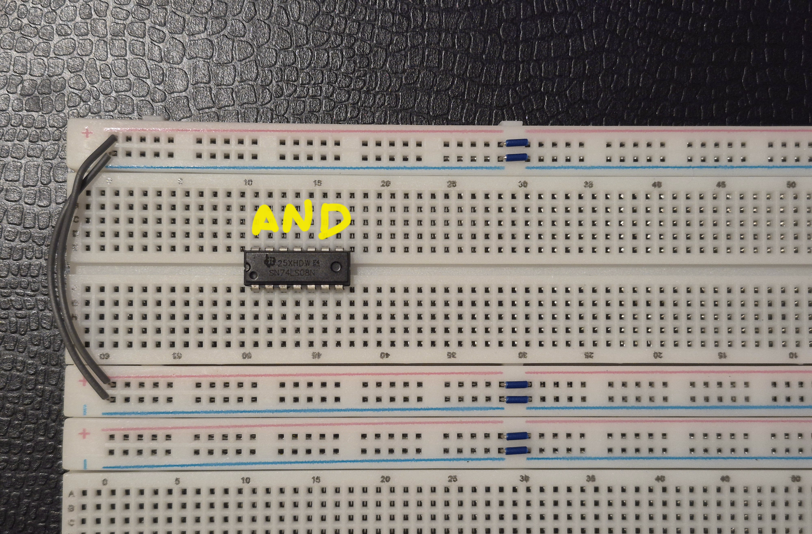

This is the first part of our boolean expression which is A.B:

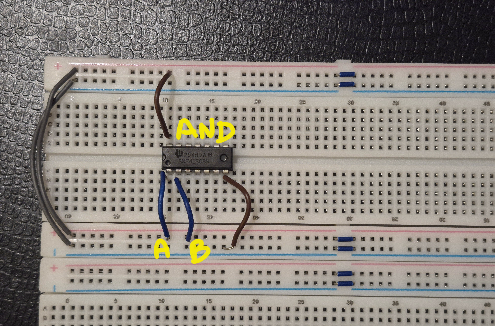

Get the 7404 IC which is NOT gate to invert B input as in the second part of our expression we have A.B':

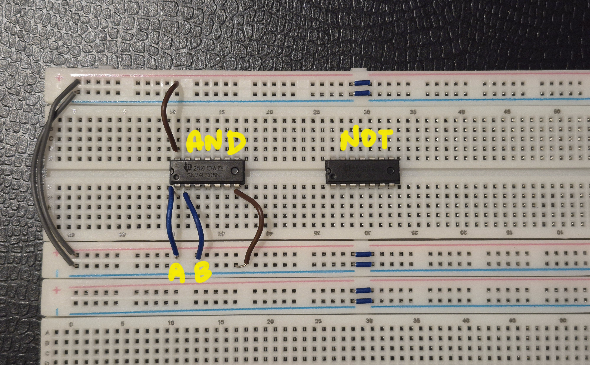

Get the B input....

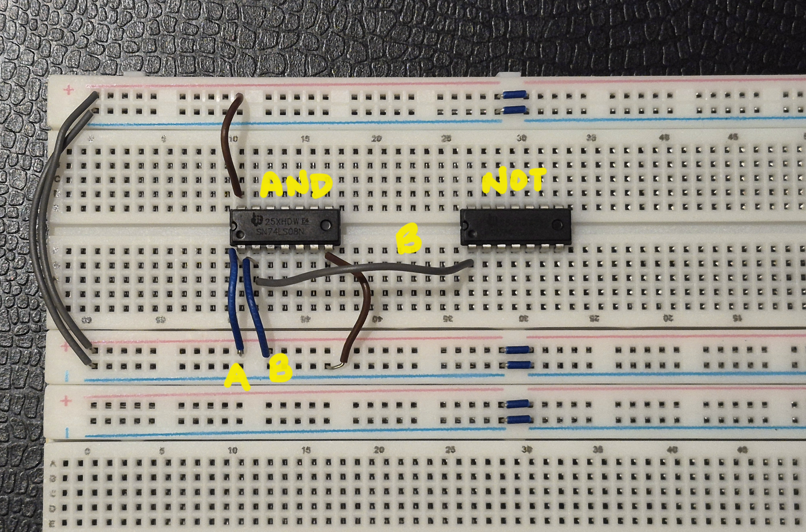

Get the second 7408 IC as we have to do A.B'. We could have used the same AND IC we used for A.B but for convenience I used a second chip:

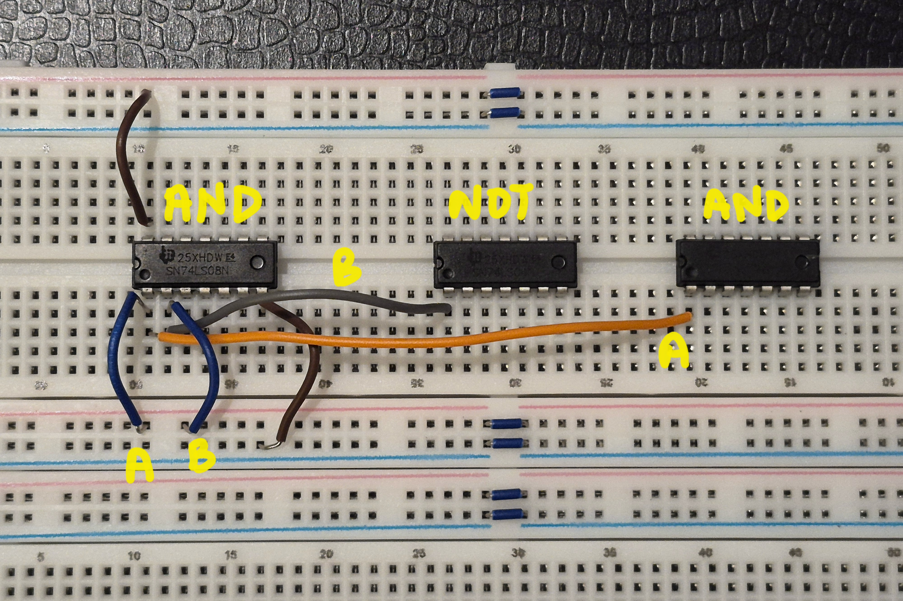

Get the same input A which we used in our first 7408 and get it as the first input in our second 7408, and also get the inverted B in our second 7408:

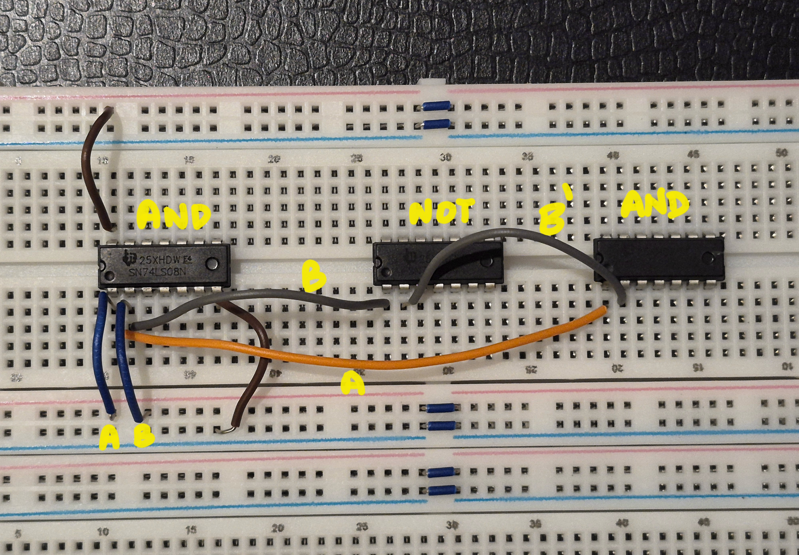

We have to OR the results of both the 7408 ICs.... 

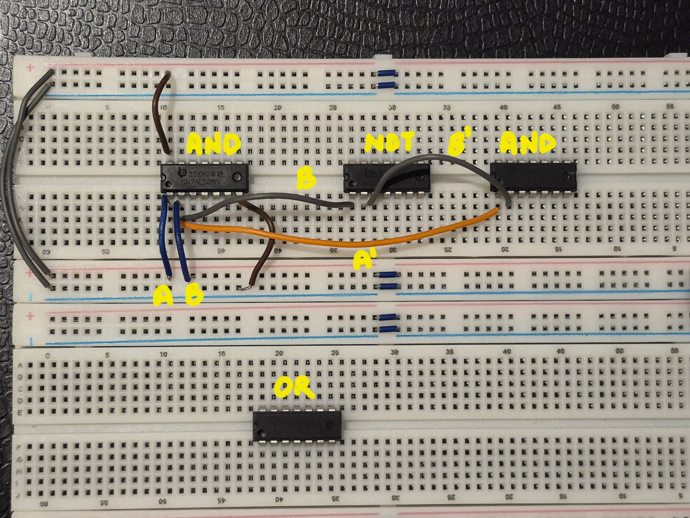

The first input to 7432 IC comes from the result of A.B:

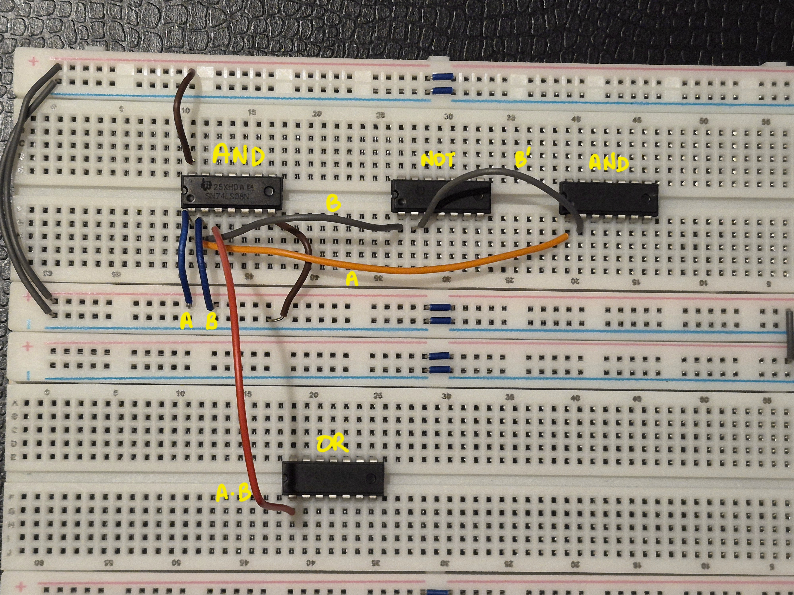

The second input to our 7432 IC comes from A.B':

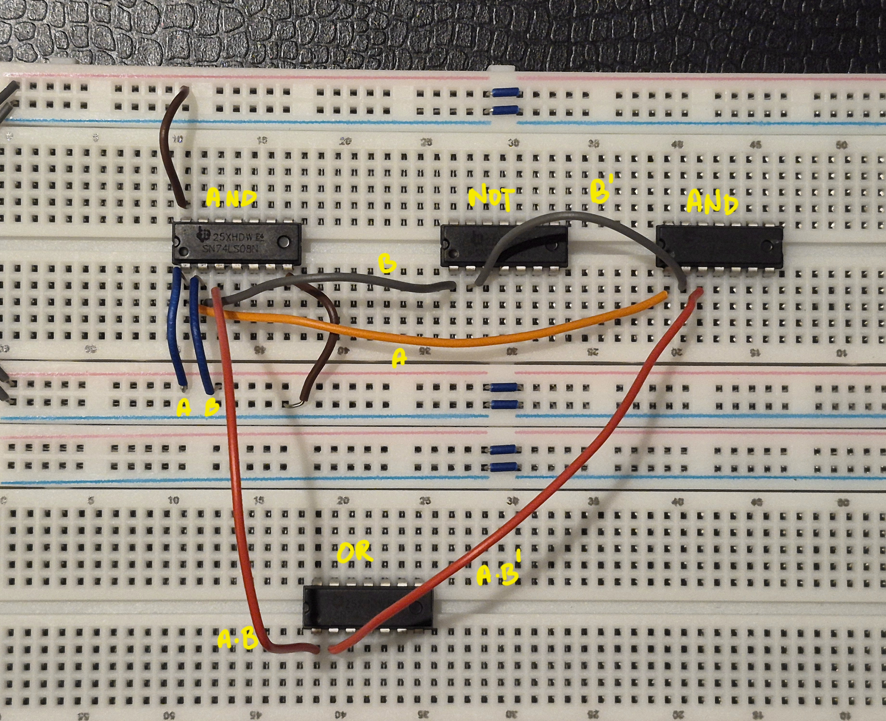

Get our LED to test whether we did things right:

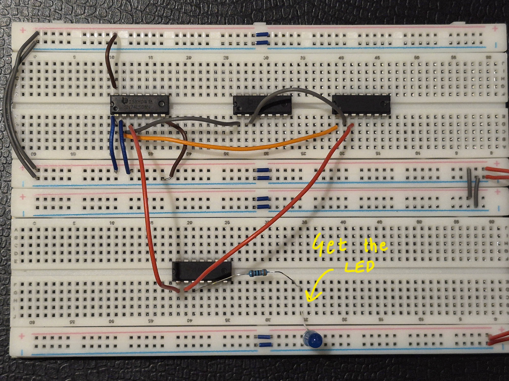

Don't forget to supply power to the IC:

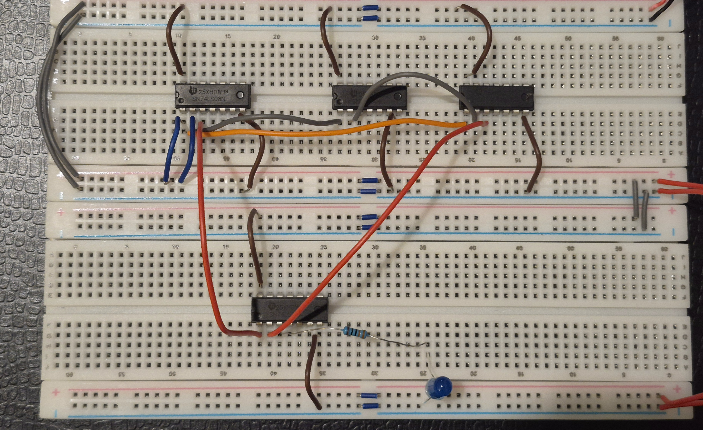

Lets see whether our simplification is correct or not. This will get proved if for every time A is 1, we get the output as 1, means the LED lights up. Lets start with the first row of the truth table:

| A   | B   | B'  | A·B | A·B' | A.B + A.B' | A   |
| --- | --- | --- | --- | ---- | ---------- | --- |
| 0   | 0   | 1   | 0   | 0    | 0          | 0   |

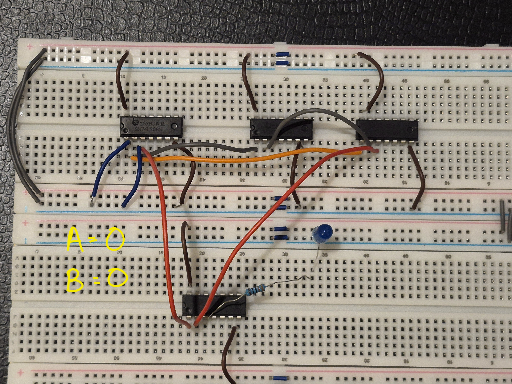

The result of `A.B+A.B'` is 0 and A is 0 too! Our LED does not light up.

Case 2:

A is 0 so A.B+A.B' is 0 too again so LED again won't light up:

| A   | B   | B'  | A·B | A·B' | A.B + A.B' | A   |
| --- | --- | --- | --- | ---- | ---------- | --- |
| 0   | 1   | 0   | 0   | 0    | 0          | 0   |


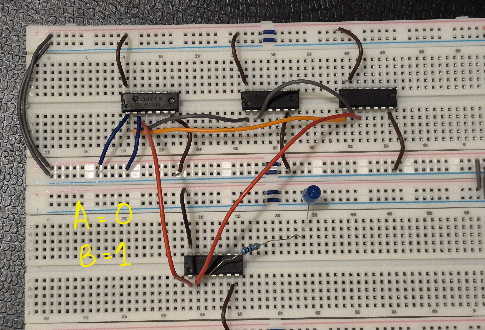

Case 3:
Since A is 1 so A.B+A.B' is also 1 and the LED lights up... 

| A   | B   | B'  | A·B | A·B' | A.B + A.B' | A   |
| --- | --- | --- | --- | ---- | ---------- | --- |
| 1   | 0   | 1   | 0   | 1    | 1          | 1   |

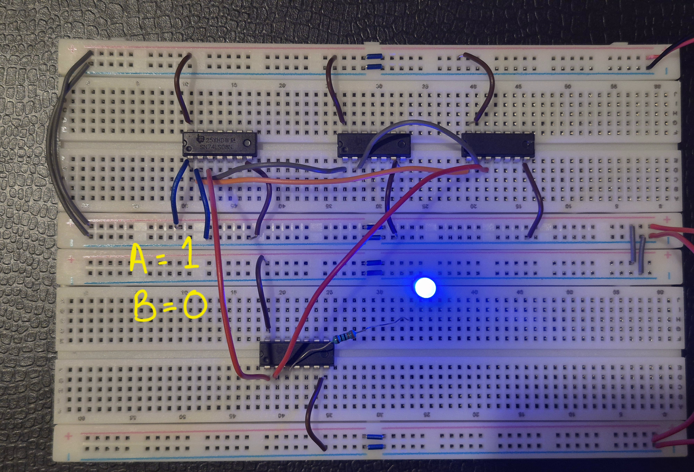

Case 4:
Since A is 1, the result of A.B+A.B' is 1 and LED lights up proving our simplification correct!

| A   | B   | B'  | A·B | A·B' | A.B + A.B' | A   |
| --- | --- | --- | --- | ---- | ---------- | --- |
| 1   | 1   | 0   | 1   | 0    | 1          | 1   |

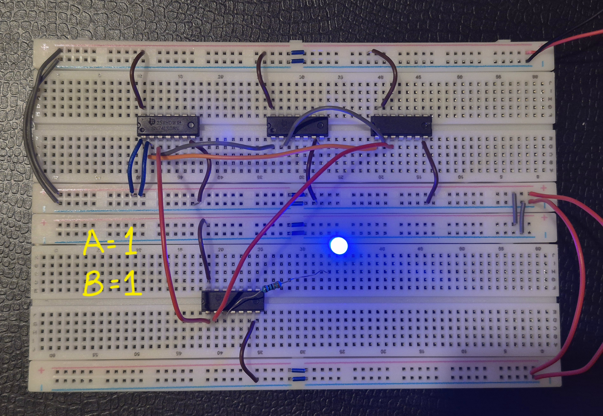

Lets try another example to get a better grip on Boolean algebra and simplification of boolean expressions:
### Example 4: (A' + B')(A + B)

```
F = (A' + B')(A + B)
  = A'A + A'B + B'A + B'B     (distributive)
  = 0 + A'B + AB' + 0         (complement)
  = A'B + AB'                 (identity)
```

The result is the XOR function. So a NAND gate and an OR gate, joined by an AND gate, work as an XOR gate. So how do we know that `A'+B'` is a NAND gate? We know that AND Gate is A.B, and NAND is an inverted AND, so lets do something like...
```
(A.B)'...
Applying De Morgan's Law:
A'+ B'
```
Lets make the truth table for this:

| A   | B   | A'  | B'  | A' + B' | A + B | (A' + B') . (A + B) |
| --- | --- | --- | --- | ------- | ----- | ------------------- |
| 0   | 0   | 1   | 1   | 1       | 0     | 0                   |
| 0   | 1   | 1   | 0   | 1       | 1     | 1                   |
| 1   | 0   | 0   | 1   | 1       | 1     | 1                   |
| 1   | 1   | 0   | 0   | 0       | 1     | 0                   |

And for our simplified expressions:

| A   | B   | A'  | B'  | A' .B | A.B' | A'B + AB' |
| --- | --- | --- | --- | ----- | ---- | --------- |
| 0   | 0   | 1   | 1   | 0     | 0    | 0         |
| 0   | 1   | 1   | 0   | 1     | 1    | 1         |
| 1   | 0   | 0   | 1   | 0     | 1    | 1         |
| 1   | 1   | 0   | 0   | 0     | 0    | 0         |

So we see the results of the simplified version of the boolean expression and the original boolean expression are the same. Lets get our hands dirty with a breadboard for the simplified version. We will use two 7408s and one 7404:

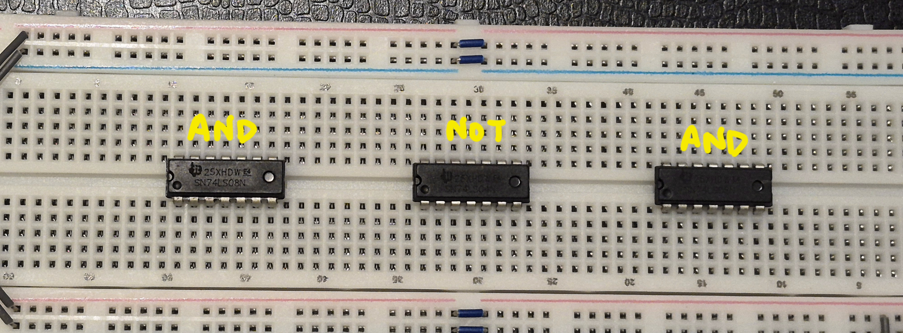

Make sure to supply power to each:

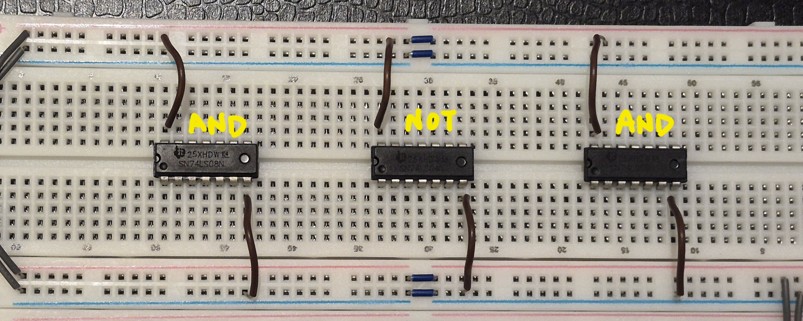

Get the input wire A to pin 1 on 7404:

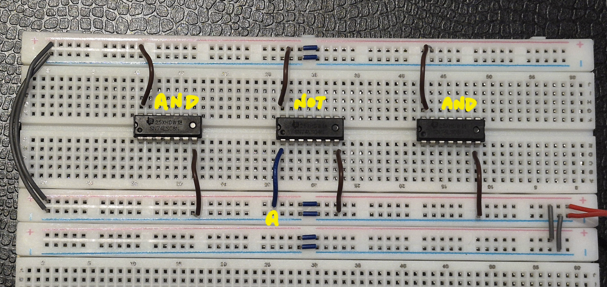

Pin 2 of 7404 outputs the inverted A input which goes as input to pin 1 on our first 7408 IC:

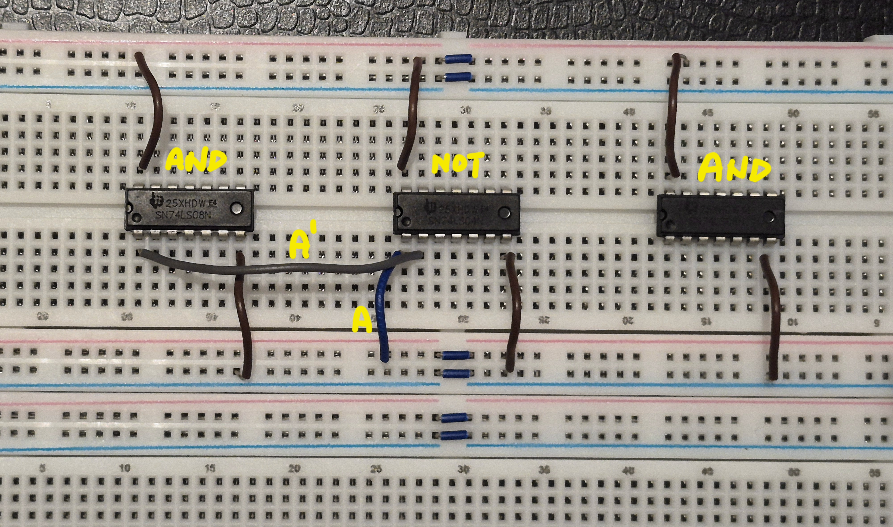

Get the same input A to 7404 to the second 7408 IC at pin 1:

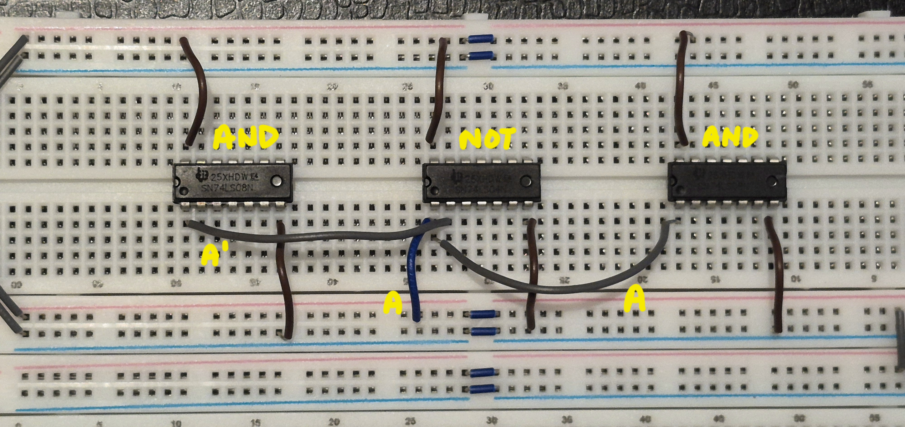

Now get the input wire B in the third pin of the 7404 IC:

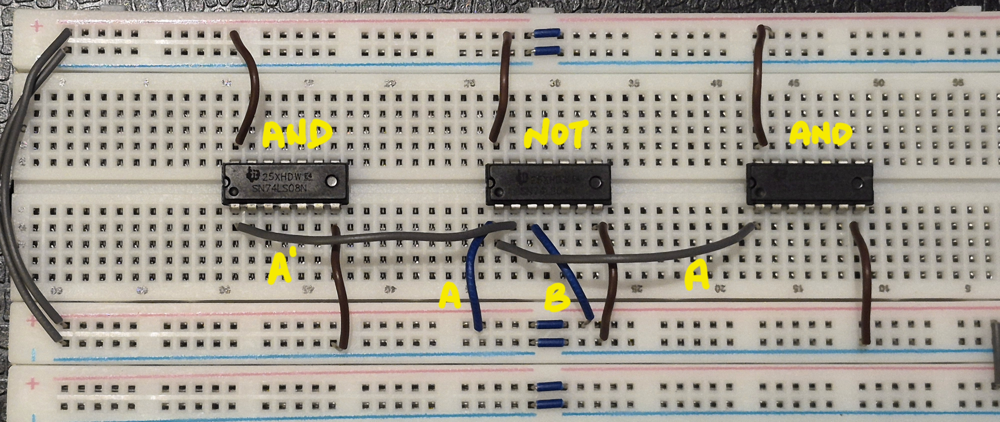

From the same column where you inserted input B in 7404, get B input to the second pin in the first 7408:

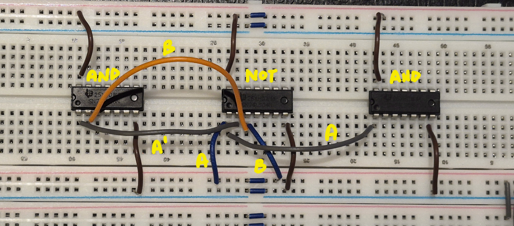

From the 4th pin in 7404 which should output inverted B, get a wire to the second pin in the second 7408:

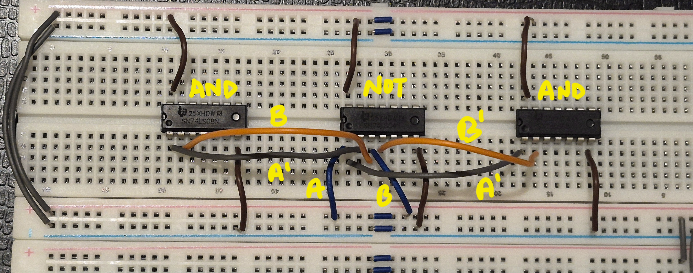

The output for the first 7408 should give `A'B` which will be the first input to our 7432:

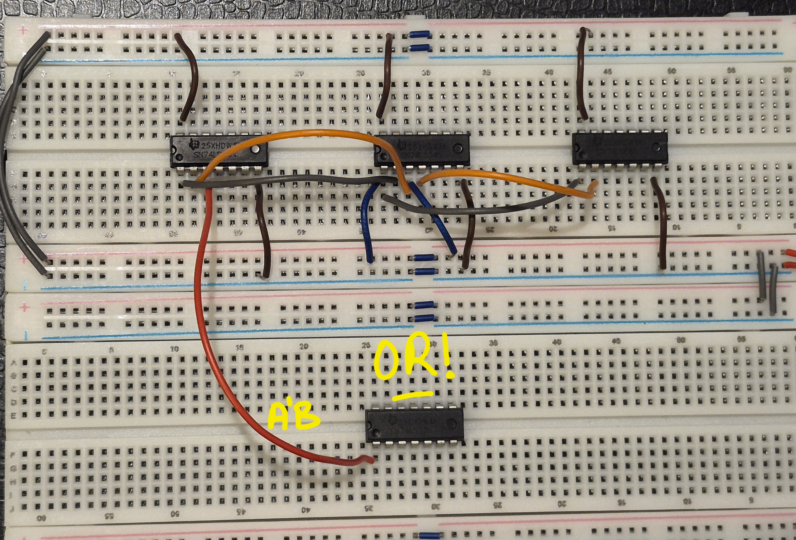

Similarly from our second 7408 we have `AB'` which will be our second input for 7432:

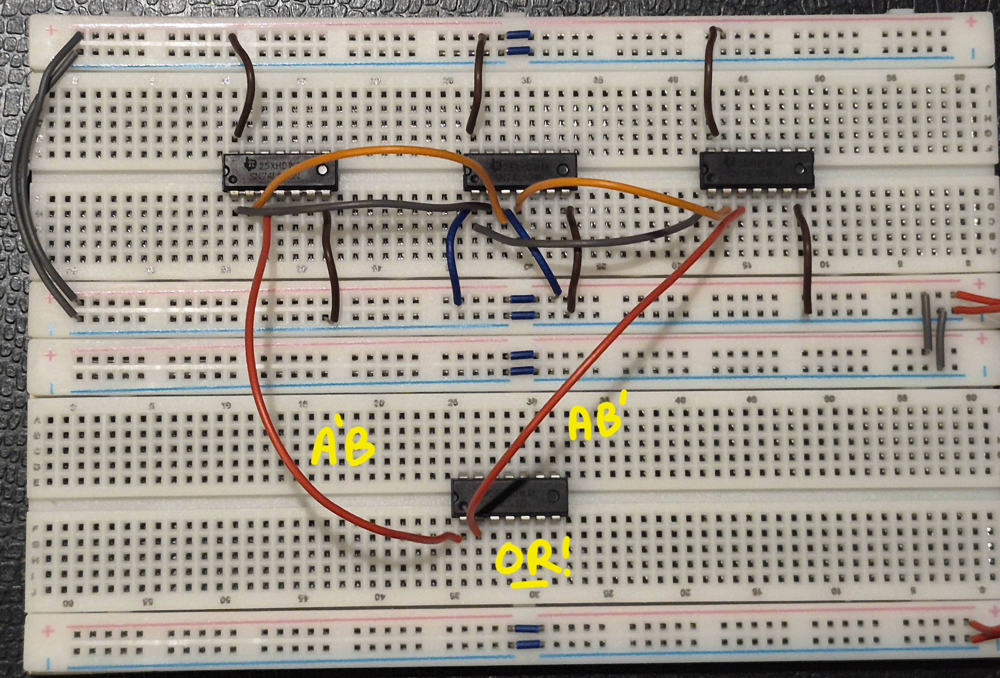

Get the resistor...

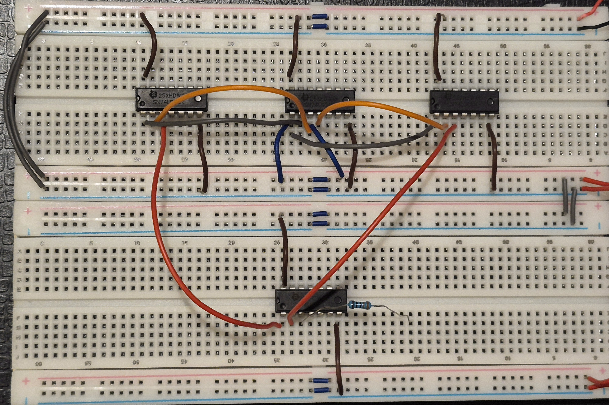

Now lets analyze when A is at HIGH supply and B is at ground, the LED lights up:

| A   | B   | A'  | B'  | A' .B | A.B' | A'B + AB' |
| --- | --- | --- | --- | ----- | ---- | --------- |
| 1   | 0   | 0   | 1   | 0     | 1    | 1         |


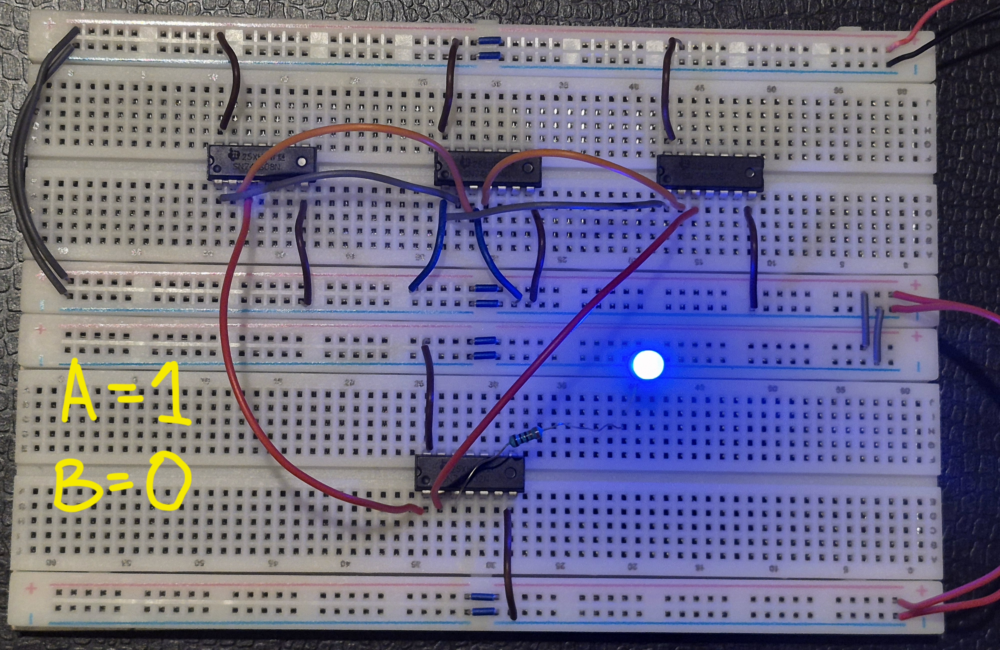

When both A and B are HIGH, our output is 0:

| A   | B   | A'  | B'  | A' .B | A.B' | A'B + AB' |
| --- | --- | --- | --- | ----- | ---- | --------- |
| 1   | 1   | 0   | 0   | 0     | 0    | 0         |

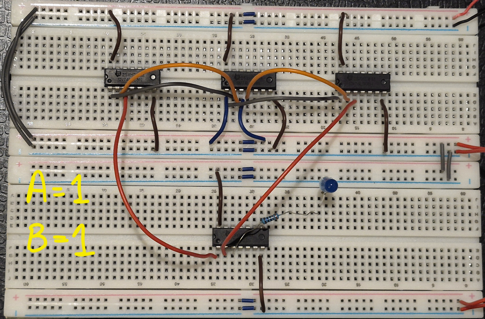

When both A and B are LOW, our output is again 0:

| A   | B   | A'  | B'  | A' .B | A.B' | A'B + AB' |
| --- | --- | --- | --- | ----- | ---- | --------- |
| 0   | 0   | 1   | 1   | 0     | 0    | 0         |

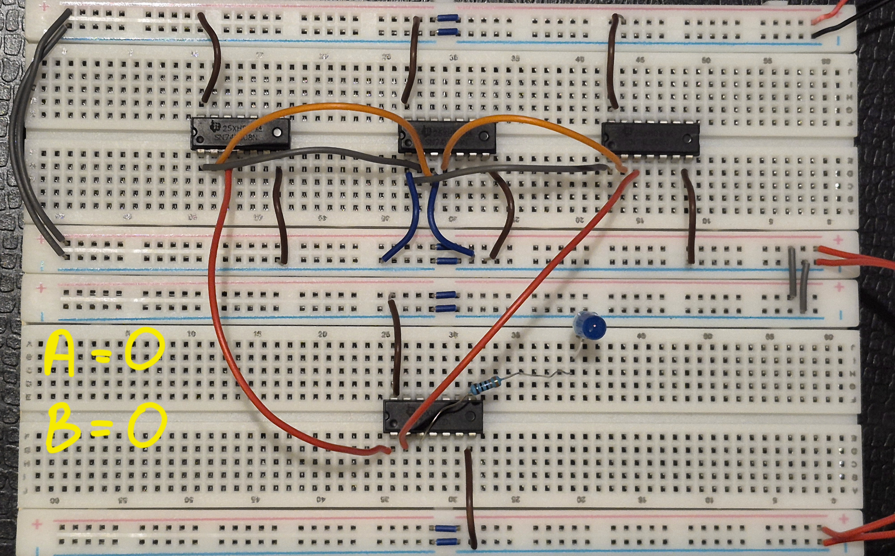

When A is 0 and B is 1, then our output is again HIGH:

| A   | B   | A'  | B'  | A' .B | A.B' | A'B + AB' |
| --- | --- | --- | --- | ----- | ---- | --------- |
| 0   | 1   | 1   | 0   | 1     | 1    | 1         |

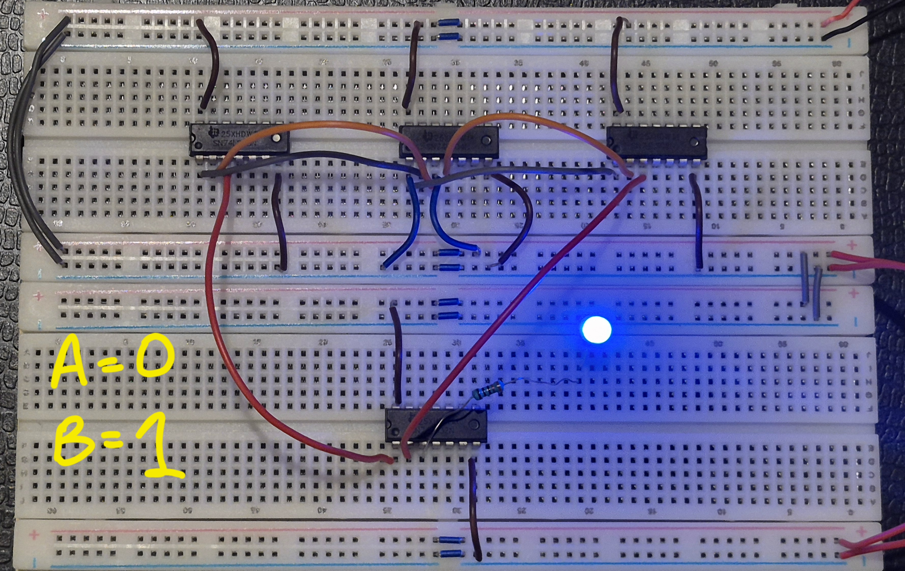

This exactly mimics an XOR gate!

## Some tips for simplifying...

1. **Remove the long bars first.** Use De Morgan's theorems to push every NOT down to single variables.
2. **Expand the brackets** with the distributive law.
3. **Look for easy wins:** A + A, A·A, A + A', A·A', and terms with 0 or 1.
4. **Look for common factors** and take them out.
5. **Look for absorption:** a small term sitting inside a bigger one, like A and AB.
6. **Check your answer** with a truth table. Compare the original and the simplified expression for every input.

Simplifying by algebra needs practice, and there is no fixed recipe. Different people may take different steps and still reach the same answer. If you are not sure whether your answer is the shortest, the truth-table check at least tells you that it is **correct**.

